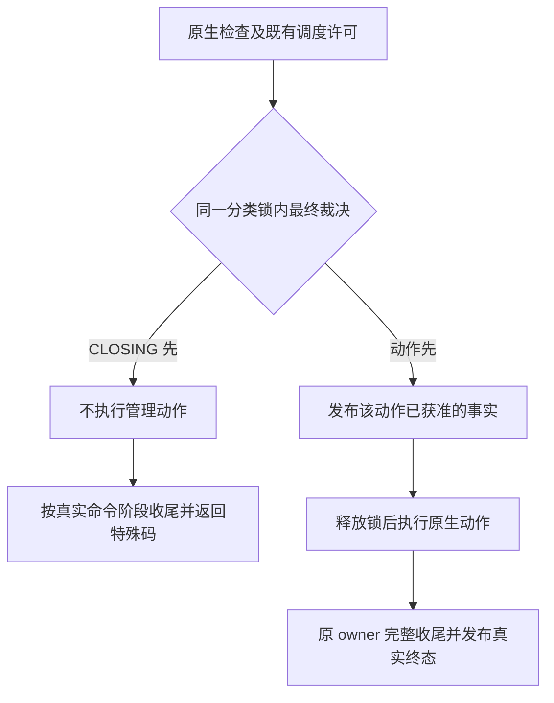
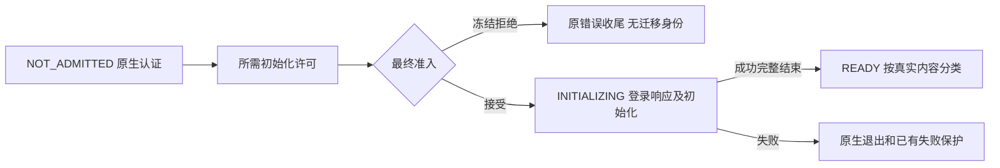
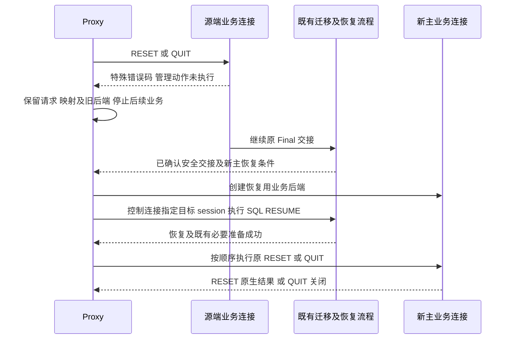

# Preserve Trx 连接管理命令跨主交接设计

日期：2026-10-12。实现基线：`ha_preserve_trx`，`bc09a3e741ceea6ac978195e5ff1324756c78aca`。**已实施并完成 MTR 回归及本地 Release 复测**；本文区分源码风险、基线 RED 和当前运行结果，保留性能缺样本，不代表真实 proxy／物理升主工程已经完成集成验收。

## 1 背景、目标和范围

DRAIN 期间仍会收到连接关闭、重置和新建请求。QUIT/RESET 可能回滚事务、释放锁并销毁 TEMP/cursor；新连接初始化可能产生新的事务和临时资源。这些动作必须与最终迁移集合的确定有明确先后关系，不能同时出现“已在源端执行”和“按未执行交给新主”。

**统一目标：CLOSING 截住尚未获准的连接管理动作，返回已有特殊错误码；已经获准的动作由源端完成，按真实完成状态参与后续分类。** proxy 保留被截住的请求，新主恢复对应旧会话后再执行。真正的新逻辑连接没有旧资源，只需在新主重新建立。

| 本次覆盖 | 保持现状或不扩展 |
| --- | --- |
| Preserve ON、standby transfer、Classic 普通业务连接 | OFF、local 模式及其他非本次模式保持原行为 |
| `COM_QUIT`、`COM_RESET_CONNECTION`；新连接准入及初始化 | 不扩展 KILL CONNECTION、RESET DRAIN、local startup、X Protocol、HANDLER |
| 已支持的活动事务、READ_CONTEXT、resource-only TEMP/cursor、session-only | `COM_CHANGE_USER` 保留现有拦截；不增加通用业务重放 |
| 既有 Final、READY、物理升主、SQL RESUME 和原生清理 | `COM_STMT_CLOSE` 仍是静默的 PS 关闭及既有补发合同；LONG_DATA 原生规则不改 |

**HA 模块用户连接的特殊行为由物理复制工程处理，不在本文设计范围内。** 保持既有过滤、权限和集成接点，不新增账号识别或豁免规则。真实网络 EOF/FIN/RST 不属于完整管理命令，不能向已断开的连接承诺特殊响应；沿用原有异常断线与所有权保护。

**物理复制工程的 Preserve 总开关是静态开关**，原生调用点由该总开关隔离；本设计不增加运行中 ON/OFF 切换、存量连接补登记或额外扫描。本地源码也通过 [enable 校验](/Users/a1234/project/mysql-server-8022-preserve-port/sql/preserve_trx_resource.cc:772) 和 [artifact mode 校验](/Users/a1234/project/mysql-server-8022-preserve-port/sql/sys_vars.cc:1127) 禁止运行中改变对应值；OFF/非本次模式继续走原路径。

**本次新增处理只适用于 standby transfer，不设计 local 模式的连接管理交接或恢复。** 统一最终准入、初始化 owner、扫描条件和 guard 的新增逻辑都须限定在这一范围，不能仅凭 Preserve ON 激活；共用 helper 在 local 模式保持既有行为。下文 legacy 指 standby transfer 的既有非依赖调度路径，不指 local 模式。

本文用 **T** 表示原有 token 迁移目标，用 **S** 表示 session-only 身份；是否进入 T/S 由真实事务和资源决定，不能按是否存在 THD 推断。

## 2 五条统一规则

| 规则 | 实现约束 |
| --- | --- |
| ① 原许可先行 | 保留原生认证、protocol/SQL gate 和既有 scheduler 许可；等待期间不持分类锁。仅对已经获准的同一初始化保留继续执行资格，见 §4。 |
| ② 副作用前最终准入 | 在现有分类锁内重查 CLOSING/迁移状态，并在 THD 锁下发布获准事实，与 CLOSING 发布及初扫形成明确先后关系。CLOSING 先赢则拒绝，动作先赢则源端完成。 |
| ③ 拒绝即未执行 | 不先清理、回滚、退出或接受新业务会话再返回特殊码。scheduler `EXECUTING` 是工作单元许可，不等于管理副作用已发生；最终拒绝后仍按真实 stage/事务收尾。 |
| ④ 扫描消费事实 | 未准入连接不进 T/S；已获准但未完成的工作必须被跟踪；完成后按真实状态分类。解码 QUIT、临时 killed 或 THD 存在都不能代替这些事实。 |
| ⑤ 原 owner 完成一次 | guard 归还、scheduler finish、连接可服务和原生 teardown 各守自己的边界，不互相代替。保留已有 generation、pin、目标丢失、错误和超时检查。 |

**只收敛裁决，不强行统一生命周期。** 在已有 Preserve 专属模块内使用一个小的最终准入 helper，处理范围判断、锁顺序、最终检查、对应事实发布和返回决定；三个固定接点传入操作种类。不把认证、scheduler 等待、网络响应、原生清理、T0 登记或候选分配塞进 helper，也不构建通用连接管理框架。

锁顺序固定为 **分类锁 → `LOCK_thd_data`**；持锁期间不执行网络、SQL、rollback 或 scheduler 等待。依据：[CLOSING 发布与初扫](/Users/a1234/project/mysql-server-8022-preserve-port/sql/preserve_trx.cc:20958)。最终裁决必须覆盖原路径所有 ALLOW 来源，包括 IDLE/Phase1，不能只在已经观察到 CLOSING 的分支补判断。

默认依赖调度和 legacy 共用这一最终规则；legacy 没有相同的 aggregate/CAS，不能要求它提供不存在的 `EXECUTING`，也不新增调度器。认证失败、原门控拒绝等情况保留原结果，不为统一特殊码而跳过原检查。

## 3 三种动作，只保留必要差异

| 动作 | 最终准入位置 | 复用或新增的事实 | 完成边界及扫描结果 |
| --- | --- | --- | --- |
| QUIT | 原协议门控 ALLOW 后、原生 QUIT 前 | 收窄已有 cleanup 字段为“源端退出已获准” | 保持到 native teardown；初扫排除获准退出，冻结 QUIT 保留原 T/S 资格 |
| RESET | 原 native/scheduler ALLOW 后、`cleanup_connection()` 前 | 复用 risky depth 的局部 guard 表示已获准清理 | cleanup 后归还 guard，完整 dispatch 后才可收敛；正常结果进 S |
| 新连接 | 认证及所需初始化许可完成后、登录成功响应前 | 一份三态连接准入事实 | 外层完整初始化成功后可服务；未完成先登记，完成后按真实内容进 T/S |

### 3.1 QUIT：解码不等于已退出

基线 [分类函数](/Users/a1234/project/mysql-server-8022-preserve-port/sql/preserve_trx.cc:11934) 在解码 QUIT 时直接设置 cleanup，[S 判断](/Users/a1234/project/mysql-server-8022-preserve-port/sql/preserve_trx.cc:5407) 因而排除它；[CLOSING gate](/Users/a1234/project/mysql-server-8022-preserve-port/sql/preserve_trx.cc:12329) 又将 QUIT 作为 cleanup 放行。仅删除白名单不足以保留正确迁移集合。

在本次 standby 普通业务范围内，`preserve_trx_post_closing_cleanup_packet` 只在最终准入成功时置位，表示源端已取得退出权。同步 classify、counter、初始/最终 S 判断及字段注释；不另加标记或做纯改名迁移。该模式边界不能仅由 scheduler 开关代替，否则 legacy 漏接。

最终准入收在现有 [protocol wrapper](/Users/a1234/project/mysql-server-8022-preserve-port/sql/preserve_trx.cc:12361) 的 QUIT ALLOW 汇合处，覆盖无 capture、IDLE、Phase1 等来源；不在原生 QUIT 分支新增 hook，不在每个 ALLOW 分支复制锁块。原生/scheduler 拒绝仍原样返回。

保留 [QUIT 不捕获 scheduler 命令](/Users/a1234/project/mysql-server-8022-preserve-port/sql/preserve_trx.cc:12438)，不将其改成 TX_END。原因是 [QUIT 主体](/Users/a1234/project/mysql-server-8022-preserve-port/sql/sql_parse.cc:2151) 只结束连接循环，实际回滚/释放发生于 [连接清理](/Users/a1234/project/mysql-server-8022-preserve-port/sql/conn_handler/connection_handler_per_thread.cc:300)。退出标记不能在 dispatch finish 清除；已预声明但随后本地退出的会话仍走既有最终裁决和未选中声明清理。

拒绝返回已有 `BLOCK_CLOSING_DRAINED` 并走统一 ERR 路径，不能再进入原生 QUIT 的 `disable_status()`/退出分支，也不把 QUIT 加入响应抑制列表。既有延迟 4020 不要求 QUIT 被 capture；已 `PRESERVED_DRAINED` 的快速拒绝保持。

### 3.2 RESET：只发布清理期间的事实

基线 [RESET 主体](/Users/a1234/project/mysql-server-8022-preserve-port/sql/sql_parse.cc:1739) 同步清理；[cleanup](/Users/a1234/project/mysql-server-8022-preserve-port/sql/sql_class.cc:934) 暂写 `KILL_CONNECTION`，[RESET](/Users/a1234/project/mysql-server-8022-preserve-port/sql/sql_class.cc:883) 随后恢复。其间 [counter](/Users/a1234/project/mysql-server-8022-preserve-port/sql/preserve_trx.cc:6013) 可能将仍将继续服务的连接当退出而遗漏。这是待运行复现的静态交错风险。

最终准入成功才增加 `preserve_trx_inflight_risky_statement_depth`，不伪造 SQL 类别，不新增 RESETTING 状态。guard 仅包住 RESET 清理分支：cleanup 恢复 killed 后归还，必须早于 [dispatch 改回 COM_SLEEP](/Users/a1234/project/mysql-server-8022-preserve-port/sql/sql_parse.cc:2373)。扫描在 THD 锁内先查 risky depth，再短路读取稳定的 `COM_RESET_CONNECTION`；不能无条件读 `m_command` 或用早于 command 发布的 unknown depth 替代。

在已有 [Preserve_trx_inflight_statement_guard](/Users/a1234/project/mysql-server-8022-preserve-port/sql/preserve_trx_drain.h:228) 增加窄的 RESET 准入入口，接管最终准入已发布的 depth，复用原析构归还；不能再调用普通 `mark()` 重复增加 depth，也不新增 guard 类型。它是 RESET case 的局部对象，不延长到整个 dispatch。

| 消费位置 | 对同一获准 RESET 事实的处理 |
| --- | --- |
| CLOSING counter | 在临时 killed 和资源采样前识别，发布本代 PENDING/generation；正常完整命令结束沿现有 pending→S 收敛。冻结拒绝的 RESET 不置 guard，仍按原资源分类。 |
| T0 初扫 | [collector](/Users/a1234/project/mysql-server-8022-preserve-port/sql/preserve_trx_standby_phase2_scheduler.cc:1551) 基线先按 killed 过滤，再看 EXECUTING。须保留“获准 RESET guard＋EXECUTING”的工作登记/退出配对，其他 actor 过滤不变；此分支不采样清理中的 SQL 事务或 engine cookie，完成后观察真实事务状态。 |
| Phase1 提前准备 | guard 存在时跳过变动中的资源采样；正常结果为 S，不强制增加预声明。readiness 仍是观测，不能代替最终 counter。 |

guard 归还不代表 idle；真实退出、失败、异常残留资源和超时仍按原保护处理。RESET 不调用连接销毁的 `release_resources()`，不为并不存在的 teardown 回调取消增补逻辑。

若原 scheduler 已进入 EXECUTING、最终裁决却被 CLOSING 拒绝，原生清理仍未发生：按真实阶段和未变事务执行 finish，**不倒退为 CUTOFF、不伪造 `entered_body=false`**。RESET 保持原分类和依赖许可。

## 4 新连接：允许建立 THD，明确是否已准入

### 4.1 一份状态，不改变原生创建顺序

当前 [连接 handler](/Users/a1234/project/mysql-server-8022-preserve-port/sql/conn_handler/connection_handler_per_thread.cc:295) 先创建/注册 THD，再认证；[握手网络回调](/Users/a1234/project/mysql-server-8022-preserve-port/sql/conn_handler/init_net_server_extension.cc:73) 也经过 Preserve 包头 hook。**需要隔离的是迁移准入，不是禁止创建 THD。** 不改原生注册/认证顺序，不把“accept 时提前拒绝”当作解决竞态的必要机制。

增加一个每 THD 固定大小枚举；新 THD 初始化为 NOT_ADMITTED，普通 RESET 不重置此连接生命周期事实。状态使用 THD 锁读写，不用 `priv_user`、COM_SLEEP/CONNECT 或 `m_server_idle` 猜测准入。

另保留一个短期初始化 owner 指针：owner 在 `thd_prepare_connection()` 栈上，快照、执行决定和完成责任放在 owner 中，声明/实现在既有 Preserve 文件。指针只供当前连接线程借用；扫描/worker 只读锁内发布的状态和既有命令事实，不跨线程解引用栈对象。字段使用类内初始化，不修改 `sql_class.cc` 的构造/RESET 路径；scope 退出前解除绑定，不建立全局 THD→owner 表。

| 状态 | 迁移与工作跟踪 |
| --- | --- |
| NOT_ADMITTED | 握手包不标记成业务命令；不进 target/token/S。但若已捕获初始化 synthetic 身份，T0 必须照常追踪，不能一律跳过。 |
| INITIALIZING | 最终准入已接受；尚不能交给 worker 接管，初扫登记完整初始化在途工作和候选。 |
| READY（连接可服务，非 receiver READY） | 完整初始化成功；沿原业务命令、事务/资源及 S 判断。失败分支不发布 READY。 |

### 4.2 初始化沿用一个外层工作单元

[login_connection](/Users/a1234/project/mysql-server-8022-preserve-port/sql/sql_connect.cc:706) 先发登录响应，随后执行 `prepare_new_connection_state()` 和 `init_connect`。保留此协议顺序，由 **`thd_prepare_connection()` 外层**持有完整生命周期，覆盖登录及所有初始化出口。不能简单将 OK 后移：原生初始化错误处理可能读取下一客户端请求，压缩协议也已切换。

先确定初始化定义和执行决定，再对确需执行的 SQL 接线：

1. 在原配置锁下取得单次定义快照，释放配置锁后再做权限判断、BODY 等待和最终准入。`sql_connect.cc` 提取一个文件内小函数，按原来的“长度 → SUPER/CONNECTION_ADMIN → password_expired”顺序返回 `EMPTY / SKIP_ADMIN / SKIP_EXPIRED / EXECUTE`；owner 保存这次决定。prepare 直接消费它，无 owner 才由同一函数走原判断。空快照和跳过决定都是有效结果，不能回退读取后来的全局配置；原过期告警仍在原位置发出。
2. 仅 `EXECUTE` 在登录成功响应前捕获现有 synthetic 命令身份，**compound 与 identity 在同一 THD 同步边界发布**，随后取得原有 BODY 许可。不能仅 capture/过 COM_QUERY protocol gate，也不能 capture 返回后补 compound；此时 T0 可能已经看到 EXECUTING。
3. 再执行 §2 的最终准入，接受则发布 INITIALIZING。若拒绝而 BODY 已获准，SQL 尚未执行，但须在锁外以真实 stage/事务 finish，不新增 cancel API。
4. 解锁后按原顺序发送登录响应、执行初始化。[execute_init_command](/Users/a1234/project/mysql-server-8022-preserve-port/sql/sql_parse.cc:1115) 保持原签名；只对匹配当前 owner 的 `init_connect` 调用借用同一快照/aggregate，其他调用保留原配置锁及 `thd->strmake` 路径。原生 CLIENT_MULTI_QUERIES、Vio、profiling 及清理顺序不动。compound 表示完整外层，允许其内部合法 COMMIT/BEGIN 换代。
5. 内层 dispatch 保留原生收尾；外层在全部初始化结束后对已捕获身份执行一次 finish，再在 THD 锁内解除 owner 绑定、发布成功 READY。**这里不发布 idle/quiesce**：首次 `do_command()` 仍需执行 LEX、诊断区和 NET 的原生前导，完成后由既有 `begin_command_read` 边界发布可接管状态，避免 worker 与连接线程同时修改上下文。错误、OOM、网络失败也只收尾一次，不发布成功状态；finish 在分类锁和 THD 锁外调用。不能只看 `thd_prepare_connection()` 返回 false：压缩或 init SQL 错误可能已设置 killed，而该函数仍返回 false，必须结合原生错误、fatal/killed 和网络结果判定。

快照由 owner 独立持有，不使用 statement MEM_ROOT：[dispatch 最后会清理该 MEM_ROOT](/Users/a1234/project/mysql-server-8022-preserve-port/sql/sql_parse.cc:2401)。`init_query_mem_roots()` 本身只设置分配默认值，不是释放操作。这里是移动原有短期复制的责任，不引入定义缓存或第二份执行副本。

以下三处是这条生命周期的必要接线，不是额外的状态规则：

| 接点 | 最小处理 |
| --- | --- |
| [native protocol gate](/Users/a1234/project/mysql-server-8022-preserve-port/sql/preserve_trx.cc:12363) | 它先于 scheduler 判定；仅将“当前借用初始化＋已准入 owner＋同一 aggregate＋EXECUTING”识别为已获准工作继续执行，不能用 INITIALIZING 单独绕过 HARD，不能靠握手 before-closing 标记。 |
| SQL/body gate | 借用初始化不通过 `body_already_entered()` 跳过 SQL gate：先执行原有 SQL 状态检查，再沿用外层 BODY、免除重复 scheduler 准入。保留真实 killed、已迁移、失败状态、权限和 SQL 错误检查；BODY 返回原生中断时保留原错误，不转换成 4020。 |
| [内层 finish/defer](/Users/a1234/project/mysql-server-8022-preserve-port/sql/preserve_trx.cc:12521) 及 synthetic begin | 在现有 Preserve helper 内集中识别同一 owner 的借用窗口，不重复 capture、不提前 retire 外层、不 defer 伪客户端响应；外层结束借用后 finish 一次。保留原生调用点及已有多语句边界，不逐个增加 owner 判断。 |

无初始化 SQL 或按原规则跳过时，仍经过最终准入，INITIALIZING 覆盖登录 I/O 和本地初始化；不伪造 SQL/引擎事务。legacy 没有 synthetic aggregate，以分类锁内已接受的同一初始化 owner 及完整返回边界证明继续执行，仍用原 pending/完成机制。两者都沿用原超时，慢登录不能从在途工作中消失。

新的外层借用只适用于本次普通连接初始化；`execute_init_command()` 的 [init_slave 调用](/Users/a1234/project/mysql-server-8022-preserve-port/sql/rpl_slave.cc:6990) 不改变。

### 4.3 初扫预留候选，不能只记 pending

已准入初始化可能在初扫时没有资源、完成后却有事务/TEMP。现有 early pipeline 按初始 [token_target_thread_ids](/Users/a1234/project/mysql-server-8022-preserve-port/sql/preserve_trx.cc:21823) 建槽，后来 QUIESCED 却无槽会 [失败](/Users/a1234/project/mysql-server-8022-preserve-port/sql/preserve_trx.cc:22492)。因此初扫对 INITIALIZING 一次完成：

- 登记已有 target 和 **provisional token 候选**，发布本代 generation、PENDING_QUIESCE、capture epoch，复用 DECLARE、pin 和执行槽；不采样变化中的 TEMP/事务，不虚增“活动事务”计数。
- 完整初始化成功后，有内容则使用原槽；无内容则沿 `no_token_target`/pending→S 和 `completed_workers` 路径结束候选，并清理未使用声明。失败/超时沿原终态，不允许提前 QUIESCED。
- 未准入者无候选；不新增晚到队列、不动态扩大 Final 集合。T0 对未准入 synthetic 工作的追踪与这里的迁移候选是两种用途，不能混为一谈。

### 4.4 响应接点与失败收尾

新增的准入拒绝和必要快照 OOM 由 owner 统一转换结果：登录 OK 尚未发送时先重置已设为 OK 的诊断区，再设 ERR；不能让分配动作直接向 OK 诊断区叠加错误。若先复制再判定跳过，保留复制结果，只有 `EXECUTE` 依赖文本副本；`EMPTY/SKIP` 不因无用副本的分配失败而拒绝连接。成功路径保留原 OK。

仅新增的登录前失败路径复用 `release_user_connection()` 归还已记账额度一次，因为该返回会绕过正常 `end_connection()`；原认证失败/登录后初始化失败仍沿原清理。handler 的 aborted/global 计数不重复处理。原 init SQL 失败时读取下一客户端请求、发 abort error 和压缩清理的顺序保留，不能改成第二次登录 ERR。

**实施前置核验：** [CR_OK_HANDSHAKE_COMPLETE](/Users/a1234/project/mysql-server-8022-preserve-port/sql/auth/sql_authentication.cc:3659) 表示认证回调可能自行完成握手响应。须核定部署认证路径的最终响应发送者和发送前准入接点；只在 `login_connection()` 加 hook 不能宣称覆盖已提前发 OK 的路径，更不能补发第二个登录响应。此核验不扩大为认证或 HA 用户规则重写。

## 5 端到端交接与失败处理

**特殊码只证明本次管理动作未执行，不证明 Final/READY。** 既有 [4020 释放点](/Users/a1234/project/mysql-server-8022-preserve-port/sql/preserve_trx.cc:23094) 早于最终 commit_epoch，不将它改成新的 Final ACK 屏障。proxy 保持旧后端至既有安全交接边界，并维护“逻辑前端 → 本次 epoch/token 或 S → 新业务后端 → 暂存请求”的对应；不能仅按可复用连接 ID 关联。

旧会话成功 RESUME 并完成既有必要恢复后，才顺序执行管理请求，不能与资源关联并发。控制连接与业务目标保持身份分离，资源属于目标业务 THD；[SQL RESUME](/Users/a1234/project/mysql-server-8022-preserve-port/sql/preserve_trx.cc:25843) 沿用既有执行上下文，[cursor 关联](/Users/a1234/project/mysql-server-8022-preserve-port/sql/preserve_trx_result_restore.cc:201) 允许由独立控制 session 调用。RESET 后不得再次覆盖旧上下文或回放旧 PS；QUIT 不向真实客户端虚构 OK。未准入的真正新逻辑连接没有旧身份，在新主重新建立而不 RESUME。

| 情况 | 处理责任 |
| --- | --- |
| 前端已关闭 | proxy 保留终止意图及清理责任；恢复用后端最终关闭，不回池，不因前端对象销毁而丢弃映射。 |
| 特殊码未确认送达、Final 失败或不确定、真实 backend EOF | 沿现有失败/所有权保护；不假定命令未执行，不凭单个特殊码恢复任意 token。 |
| SQL RESUME 失败 | 按既定合同断开前后端，不重发、不放行业务、不重试或回池；未接管 token 由原回收路径负责。 |
| 新主管理请求失败或送达不确定 | 不放行后续业务或归还池，不自动反复执行。已在源端执行的请求不因响应丢失而重放。 |

## 6 分类和资源清理不变条件

| 源端事实 | 最终处理 |
| --- | --- |
| 冻结 QUIT/RESET 尚未执行 | 保留真实活动事务、READ_CONTEXT、resource-only 或 S 资格；不能因结果已取完而丢掉活动读事务。 |
| 获准 QUIT 正在退出 | 由源端原生 teardown 完成，不选为待恢复会话。 |
| 获准 RESET 正在清理 | 在途登记优先于临时 killed/资源采样；正常完整结束转 S，异常按原检查。 |
| 未准入 / 已准入初始化 | 前者不进 T/S；后者按 §4 预留候选，完整结束后按真实状态收敛。 |

target/pin/generation 不一致、真实 KILL/teardown、worker 接管失败、超时等保护不能删除。RESET guard 不能证明没有真实 KILL；session-only 最终快照只重验计划成员，不能无条件补入晚到连接。pin 只保护对象存活，不等于阻止 rollback；源端 detach 后和目标端接管后的资源继续遵守原 owner 规则。

新主资源已由 [事务 attach](/Users/a1234/project/mysql-server-8022-preserve-port/storage/innobase/trx/trx0preserve.cc:2980)、[TEMP stage](/Users/a1234/project/mysql-server-8022-preserve-port/sql/preserve_trx_temp_restore.cc:305)、[result owner](/Users/a1234/project/mysql-server-8022-preserve-port/sql/preserve_trx_result_restore.cc:159) 挂到业务 THD。继续使用 [原生 cleanup](/Users/a1234/project/mysql-server-8022-preserve-port/sql/sql_class.cc:926) 的 rollback、MDL 释放、TEMP 关闭和结果 owner 销毁，不新增管理命令专属清理或 receiver 格式。

目标必须满足既有 pristine 条件，不能因新建后端而重复执行原初始化的永久副作用。这是物理复制工程的集成验收条件，不据外部源码不可见推断已有能力缺失。

升主只沿用 `preserved_trx_prepare_before_trx_sys_init_for_physical_promotion()`、`trx_lists_init_at_db_start()` 内既有 hook、`preserved_trx_adopt_ready_epoch_for_physical_promotion()`；恢复入口仍是 `Sql_cmd_resume_preserved_transaction::execute()`，不增加阶段或恢复算法。

## 7 最小改动范围

**常规由 server 发出最终登录响应的路径，目标为 9 个现有内核文件：3 个原生文件＋6 个 Preserve 文件，不新增文件。** §4.4 的认证响应接点须先核实，不能为守住文件数量遗漏部署插件的提前响应路径。

| 文件 | 必要改动及收敛边界 |
| --- | --- |
| 原生 `sql_connect.cc` | 外层初始化 scope、登录成功响应前薄 hook、文件内原生跳过判断提取、prepare 消费同一决定；快照/准入/诊断区转换/新增失败清理在 Preserve owner 内。 |
| 原生 `sql_parse.cc` | RESET case 局部复用 guard；初始化获取 SQL 时借用快照的小分支。执行器签名和算法不复制，不在各 dispatch 出口新增策略。 |
| 原生 `sql_class.h` | 准入小枚举、短期 owner 前声明/指针及退出字段注释；不用初始化 SQL/缓存等重对象扩充 THD。 |
| `preserve_trx.cc/.h` | 私有统一最终准入、QUIT ALLOW 汇合、初始化 owner、现有命令 helper 借用判断、counter/资格/pending 消费；分类锁不导出。 |
| `preserve_trx_drain.cc/.h` | 复用 guard 的窄 RESET 准入入口及接管；复用析构，不另建 guard 或伪造 SQL 类别。 |
| `preserve_trx_standby_phase2_scheduler.cc/.h` | compound/identity 同锁捕获、T0 登记获准 RESET/初始化；保留实际 stage、pin 和退出配对。 |

**五项收敛：** QUIT 不改原生分支；RESET 复用 guard；`execute_init_command()` 不改签名；capture/finish/defer 在现有 Preserve helper 内集中判断；扫描复用共同资格及 pending 入口。无需改 `sql_parse.h`、`sql_class.cc`、连接 handler、网络扩展、`rpl_slave.cc` 或 InnoDB；不把原生执行器/认证整体搬入 Preserve 来凑文件数。

扫描复用有明确边界，不能把不同锁域和职责合成一个有副作用的“大 predicate”：

| 既有入口 | 最小扩展 |
| --- | --- |
| [S 共同资格](/Users/a1234/project/mysql-server-8022-preserve-port/sql/preserve_trx.cc:5407) | 集中判断 READY/真正获准退出，供初始、最终、状态和超时路径复用。 |
| [pending→quiesce](/Users/a1234/project/mysql-server-8022-preserve-port/sql/preserve_trx.cc:6347) | INITIALIZING 不因内层 COM_SLEEP/网络 idle 提前完成；保留原 generation/真实终态判断。 |
| T0 / Phase1 / counter | T0 持 THD 锁时不能调用获取分类锁的最终准入 helper。Phase1 只观察/提前声明，counter 才发布本代候选；只复用调用方已持 THD 锁的无副作用判断，不能向同时有无锁调用者的 helper 注入锁内采样。 |

实施前复核的预算：**原生净增约 70–120 行，完整内核净增约 700 行量级**，含注释/空行，不含测试文档；不是实际 diff 或硬上限。相较先前原生约 150、整体约 720 行的中心估算，主要收益是减少原生侵入；策略搬入 Preserve 不计作删除，整体只预计小幅减少。统一准入、外层初始化 owner、T0 跟踪、固定候选槽和真实完成保护不能为减少行数而省略。

不为统一形式增加通用连接状态机、线程池、请求缓存、跨端事件、系统参数或持久化格式。复用已有扫描与流水线，不新增全连接扫描，不在 SELECT/DML/FETCH 热路径增加分类锁，不提高既有时间或内存预算。

## 8 验证和交付

按 **QUIT → RESET → 新连接完整切片 → 组合回归** 实施。每片先保留基线 RED 和实际执行路径，再实现/GREEN；不能将源码可达性当成已复现。新连接必须连同准入、外层身份、候选槽及失败收尾交付，不能仅加认证后的判断。

| 验收组 | 必须覆盖的结果 |
| --- | --- |
| 裁决与分类 | CLOSING 和动作各先赢、已解码尚未准入、已 PRESERVED_DRAINED；覆盖活动事务/READ_CONTEXT/resource-only/S，获准本地退出与冻结迁移不混淆。 |
| RESET 并发 | T0 初扫、HARD_QUIESCENT、HARD_DEADLINE、CLOSING 初扫及 legacy；无漏记 EXECUTING、清理中采样、临时 killed 误剔除或提前 idle。 |
| 握手及初始化 | 半包头/包体、TLS/认证交互/失败；无 init SQL、多语句、CALL、持锁后 COMMIT→BEGIN、TEMP、错误/OOM/网络失败；准入到执行之间配置空↔非空/内容改变、管理员/过期跳过和无用副本 OOM、快照跨 MEM_ROOT 清理；无双 capture/finish、虚假 READY、用户额度泄漏或 `init_slave` 回归。 |
| 固定候选槽 | 初扫无资源、初始化完成有事务/TEMP；预留后只进 S；与其他 T 混合。核对 generation、capture epoch、DECLARE、pin、槽、no_token_target/completed_workers，无残留或重复完成。 |
| 恢复清理 | 永久表及 TEMP 背景 DML、最终数据/rollback/锁；cursor 未关联/部分/全部关联均回收。目标业务 THD 与控制 THD 分离，receiver 自有 TEMP 和后续分配不受影响。 |
| E2E 失败及隔离 | 前端关闭、Final 不确定、RESUME 失败、请求送达不确定；不串会话/误放行业务。OFF、非 standby 和正常业务路径保持原行为，HA 特殊用户策略不纳入本次修改。 |

同步这些旧合同：[QUIT 最终 S 用例](/Users/a1234/project/mysql-server-8022-preserve-port/mysql-test/suite/preserve_trx/t/standby_transfer_resume_required_control_only_final_snapshot.test:70)、[token 集合 lint](/Users/a1234/project/mysql-server-8022-preserve-port/mysql-test/suite/preserve_trx/t/resume_required_token_set_lint.test:42)、[QUIT 白名单 lint](/Users/a1234/project/mysql-server-8022-preserve-port/mysql-test/suite/preserve_trx/t/code_review_resumable_trx_slices_lint.test:1783)、[RESET 截断用例](/Users/a1234/project/mysql-server-8022-preserve-port/mysql-test/suite/preserve_trx/t/batch_drain_closing_all_command_cutoff.test:231)。不能把正确的已获准 QUIT 排除行为一并改掉。

新增测试仅用 MTR/Python E2E，不新增 UT/GUnit 或 DEBUG_SYNC。QUIT 必须真实发送命令并检查响应/关闭，`socket.close()` 不等价。使用业务 SQL、普通连接和有界观测等待；历史 CLOSING 计数不能证明当前命中窗口，需本次操作及终态证据。lint 不能替代运行验收。

完成定向验证后跑 Preserve 全量 no-bin/log-bin MTR，**包括 big test**；存在独立 standby-transfer 套件则一并覆盖。分别报告业务通过、条件跳过、失败和 shutdown。Release 复测持续 500 连接 TEMP/FETCH 混合业务、sysbench 及连接 churn，比较正常业务吞吐/尾延迟、连接延迟、严格 Phase2 和 ACK→READY。

不改变模型或预算：500 连接模型沿已认可的严格 Phase2 ≤2.2 秒容忍值，其余保持各自原 2 秒门槛，ACK→READY <500 ms。功能通过与性能达标分别判断，不能把等待转移到新主首条业务来美化指标。本地桥接仅证明本仓库行为；真实 proxy 映射、物理升主及控制连接恢复在对应工程验收。

## 9 本次实施与验证记录（2026-10-12）

实现落在 §7 的 9 个现有内核文件，没有新增内核文件、线程池、参数、协议或物理升主阶段。当前相对上述基线的内核 diff 为 **+459 / −103，净增 356 行**（含注释和空行）；其中 3 个 MySQL 原生文件为 **+62 / −22，净增 40 行**。主要逻辑留在 `preserve_trx.cc/.h`，RESET 复用现有 guard，扫描复用现有候选与 pending 流程。

### 9.1 基线 RED

| 用例后缀 | 基线实际现象 | 修复后的断言 |
| --- | --- | --- |
| `create` | CLOSING 中普通业务登录成功，没有 4020 | 原认证失败仍返回 1045；认证成功的晚到连接返回 4020，不进迁移集合 |
| `quit_active` | QUIT 执行 teardown、返回 EOF | 返回 4020；活动事务仍在最终 SURVIVOR 中 |
| `quit_idle` | QUIT 执行 teardown、返回 EOF | 返回 4020；会话标记仍在，receiver 可且仅可消费一次 S 身份 |
| `partial_auth` | 未认证完连接进入 EXCLUDED / CLOSING_COMMAND_TIMEOUT | 不进 T/S 或 EXCLUDED；receiver RESUME 该 ID 返回 4023 |
| `init_connect` | 已进入初始化、尚未创建 TEMP 的连接最终导致 DRAIN 4013，`first_failure_stage=early_target_pipeline_failed` | 外层初始化完成，TEMP／事务进入最终集合，多语句 COMMIT→BEGIN 不丢失外层身份 |

证据位于 [本轮运行目录](/Users/a1234/project/mysql-server-8022-preserve-port/build-debug/preserve-connection-handoff-20261011/)：`red2-nobin.log`、`red3-nobin.log` 的半认证项，以及 `red-init-corrected.log`。早期脚本等待 deferred 4020 的顺序错误、清单列解析错误及在 init_connect 内阻塞 GET_LOCK 触发原生 1317，均不计入内核 RED。有效 init RED 使用存储过程轮询有界 SQL 条件，与当前用例一致。RESET 冻结在基线已有正常拦截，不把它冒充成新增 RED。

### 9.2 复杂场景与复核边界

新增 22 个 `standby_transfer_connection_*` MTR，共用一个 MTR include 和 Python 协议驱动。覆盖两种既有调度模式、活动读事务、TEMP＋部分 FETCH、空闲 S、半认证包头/包体、初始化晚生 TEMP／事务／S、初始化期间修改全局定义、原生 QUIT/RESET 回滚和资源销毁、原生认证/初始化错误及管理员跳过初始化。没有新增 DEBUG_SYNC 或 UT/GUnit。

`reset_race` 以 16 条真实连接、48,000 行永久表后台 DML，竞争 DRAIN 与 RESET：返回 OK 的必须完成回滚并成为 S；返回 4020 的必须保留 T；同时验证最终可见行数和值。它是并发行为保护，不证明每次均命中 cleanup 的瞬时 killed 或每个 T0 指令窗口。

独立只读审核后的三处修正：初始化外层不提前发布 idle/quiesce；原生 BODY 中断不改写成 4020；借用 scheduler 身份不绕过原有 SQL 状态检查。静态审核与运行测试均不能替代真实 proxy 的请求保留/补发及物理升主验证。

新增 `init_failed_gate` 用例先证明普通业务被原生失败状态阻止，再验证 `init_connect` 同样被阻止且没有写入；它在保留的中间二进制上 RED、最终实现上 GREEN。该 RED 用于证明审核修正有效，不冒充基线已有缺陷，见 `red-native-gate-intermediate.log`、`serial-final-nobin.log`。

两项 `loopback_*_resources` 用例验证 TEMP_UNDO、本地 SQL RESUME、PS 重放及 cursor 关联：源端已取第 1 行，新端仅 FETCH 第 2 行并断言 CURSOR_EXISTS、无 LAST_ROW_SENT，保留第 3 行待取；TEMP 更新值为 29，回滚到保存点后为 20，再执行 DML 后重放 RESET／QUIT。RESET 必须销毁 TEMP 和 PS，QUIT 必须静默断开并退出 THD。这两项不声称验证永久表未提交事务的跨端恢复。它们及 `init_failed_gate` 复用既有 DBUG 桥接／故障探针，属于仓库内部行为验证。

定向 no-bin 历史轮：**22 个业务用例通过、1 个条件跳过，shutdown_report 通过**，见 `reviewed-targeted-nobin.log`；当时包含前 19 个新增用例及受影响旧合同。随后新增的失败状态保护和 lint 修正已串行通过。最终定向 log-bin：**26 个业务用例通过、无跳过，shutdown_report 通过**，包含全部 22 个新增用例，见 `targeted-logbin.log`。

### 9.3 全量回归结论

Debug no-bin／log-bin 按顺序运行，均启用 `--big-test --parallel=4 --retry=0 --force --max-test-fail=0`，使用独立 vardir。

| 运行 | 业务通过 | 条件跳过 | 失败 | shutdown_report |
| --- | ---: | ---: | ---: | --- |
| 全量 no-bin（当时 953 个用例） | 626 | 326 | 1 | 通过 |
| no-bin 串行修正验证：旧 lint＋新增失败状态保护 | 2 | 0 | 0 | 通过 |
| no-bin 补齐最后追加的 3 个用例 | 1 | 2 | 0 | 通过 |
| 全量 log-bin（最终 956 个用例） | 666 | 290 | 0 | 通过 |

no-bin 唯一失败为 `batch_drain_context_switch_guard_lint`：提取器将新的前置声明误认为函数定义。串行复现后，仅修正提取器、保留原断言；修正后的 no-bin 串行和 log-bin 全量均通过。原完整失败日志保留，不改写为单轮零失败。

按上述最终适用结果汇总，no-bin 为 **628 通过／328 条件跳过**，log-bin 为 **666／290**，均无未处理失败；**956 个不同业务用例均至少在一种适用模式通过，18 个 big test 全部通过**。当前 Preserve/Resume 用例集中在 `preserve_trx`，standby transfer 已包含其中，无独立 `preserve_trx_transfer_stby` 目录。测试期间 9 个内核文件及最终 Debug 二进制哈希未变化。

完整命令、原始日志及逐项结果见 [验证报告](../../../build-debug/preserve-connection-handoff-20261011/README.md)、[逐项结果](../../../build-debug/preserve-connection-handoff-20261011/results.tsv)。后续 Release 复测如下；真实物理复制集成及连接管理的 TLS/认证插件专项未据此宣称完成。

### 9.4 Release 压力回归

先成功编译 Release `mysqld`，再以原规模、预算及判据运行三个持续业务模型及 M1–M12 矩阵，各配置一轮。九个内核文件与上述 MTR 版本逐项哈希一致；本轮未改变内核或工作负载。Release 二进制 SHA256：`90c51e2ca5003a09fdd61d29e756c225dff7bfacfb5b87fb7635ec6180a500b0`。

| 模型 | 本地交接功能 | strict Phase2 | ACK→READY | EXACT BODY→final ACK |
| --- | --- | ---: | ---: | ---: |
| 500连接，50 TEMP／50 FETCH／50 BOTH／350读写，持续300秒 | 442 READY＋58 session-only，原连接无遗漏 | 816.639ms | 30.483ms | N/A，无eligible BODY |
| TPC-C128，300仓库，持续300秒 | 89/89 survivor READY | 477.219ms | 0.702ms | 103.392ms |
| sysbench只写1000，128表×20,000行，300秒业务窗口 | 115/115 survivor READY | 385.662ms | 0.710ms | 128.645ms |

三项业务均持续到 DRAIN，以上为本地 DRAIN→真实 TCP transfer→receiver READY 的验证。TPC-C 与 sysbench 通过原综合验收；500 模型 strict 与 ACK→READY 达标，但缺少 EXACT 端点，原脚本仍按 `missing_exact_last_command_evidence` 判性能未通过。survivor 少于并发数并非遗漏：其余事务已在切换前完成，按原连接身份和最终集合核验。

M1–M12 的 **62/62 配置通过原场景验收**，其中56个成功迁移、3个无DRAIN对照、3个预期拒绝。成功迁移累计336 READY；56项 strict 最大1232.759ms（≤2秒），ACK→READY 最大27.500ms（<500ms）。EXACT 仅1项有有效样本31.173ms，另外55项 `NO_ELIGIBLE_BODY` 为N/A。deadline负例的4个NOT_READY不计入成功迁移的性能分母。M11 memory/inflight 还核对拒绝后原连接的TEMP聚合、剩余FETCH、UPDATE／ROLLBACK正确，receiver工作资源最终归零；全矩阵捕获失败增量为0。矩阵2643个冻结输入前后未变。

单轮结果不代表长期稳定性或性能因果改善。三模型及矩阵未执行真实物理升主、SQL RESUME及恢复后业务；§9.2 的本地桥接覆盖独立列示，不扩大为生产proxy验收。500模型取证后触发既有单向purge停止的关机断言；部分模型按原脚本主动终止源端，不能称两端均正常退出。日志、失败记录和数据归档保留在本地构建目录，不纳入源码提交。

证据：[三模型完整指标及边界](../../../build-release/preserve-connection-pressure-20261012/README.md)、[三模型版本核对](../../../build-release/preserve-connection-pressure-20261012/final-identity.json)、[M矩阵及M11独立复核](../../../build-release/preserve-matrix-20261012/README.md)、[矩阵版本与逐项校验](../../../build-release/preserve-matrix-20261012/final-verification.json)。
