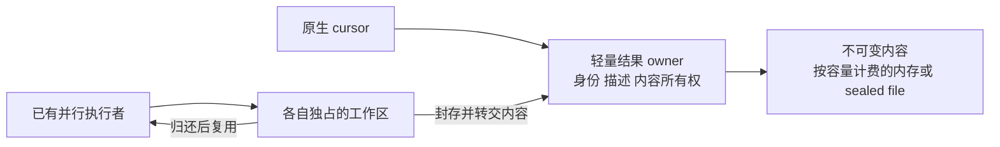
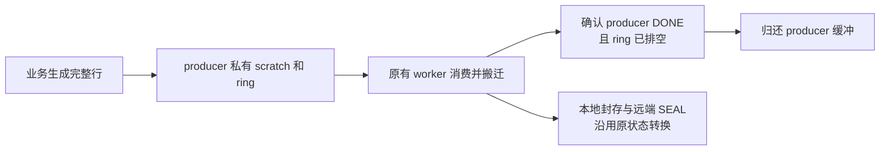

# Cursor 捕获缓冲复用与万级迁移设计

日期：2026-10-11（活动工作槽语义修订）。源码基线：`ha_preserve_trx`，`48cab89fa3a`。

本设计把捕获、发送及 receiver 校验使用的工作缓冲，与已经完成的结果分开管理。目标是保持两端各自的 Preserve 全局内存预算 **2 GiB**，使用 **Preserve 参数的新默认值、原生连接／PS／FD 容量满足负载**的配置，分批迁移 **所有 session 合计 10,000 个待 FETCH 的 Classic cursor**。**现有各阶段的并行度、跨阶段重叠和状态机是硬约束，不能用串行化换取内存下降。** 文中“当前”及源码行号描述上述设计基线。实施差分与实际验收单列在[实施记录](cursor-buffer-reuse-implementation.md)，不能把设计要求当成已通过的测试。

## 背景与目的

**业务背景。** 同一个业务 session 可以同时保留多个服务端 cursor。查询已经执行并生成结果，客户端通过后续 FETCH 分批读取，结果可能由 MySQL 内部临时表承载。业务运行中执行 DRAIN 后，需要通过 standby transfer 将这些结果送到物理备机；备机在线升主、SQL RESUME、系统已有 PS 回放及 cursor 关联完成后，客户端沿原来的读取位置继续 FETCH，不重新执行 SELECT 来重建结果。既要处理 DRAIN 开始时的存量，也要处理 Phase1 业务继续生成、关闭和重建的结果，最终以命令边界仍须保留的结果为准。普通 SELECT 已发送到网络或客户端缓冲区中的数据不属于此范围。

**本次设计的触发问题。** 当前 `rds_preserve_trx_result_capture_max_count=256` 限制的是仍被持有的捕获结果对象总数。结果捕获和传输完成后，原生 cursor 或其他有效引用仍可能持有对象，数量额度要到对象最终析构才归还。因此它不是“每批处理 256 个”的并发参数：当 10,000 个结果都需要同时保留时，不能指望处理完一批后就自动腾出 256 个名额，继续排队即可成功。[S1–S2]

**仅调大数量默认值还不够。** 当前源端对象把工作缓冲与长期结果放在一起，receiver 也随每个结果保留读取和行缓冲。数量扩大后，已经完成的结果仍占着不再使用的工作内存；调度中反复扫描历史结果还会放大 CPU 成本。必须同时处理数量上限、缓冲寿命与重复扫描，才能在原预算内提高容量，而不是把失败从数量限制推迟到内存不足。

**要达到的效果。** 让处理中的任务复用各自执行者的工作缓冲，完成的结果保留必要内容、描述、身份及消费位置；不让每个长期结果继续携带整套捕获／校验 scratch。源端和 receiver 分别在各自的 2 GiB Preserve 全局预算内核算：分批处理工作，最终选中的 10,000 个结果仍须同时可恢复。DRAIN 前不新增结果扫描、大缓冲分配或锁路径；DRAIN Phase1 尽量完成源端捕获、发送及 receiver 准备，允许事先配置更长的 Phase1，减少留给 Phase2 和 READY 的工作。万级结果的容量验收与既有性能门槛分别核对，不能用功能成功代替性能通过。

本次只优化结果资源的容量和处理成本。用户临时表的迁移、事务恢复、PS 回放及固定升主接点沿用已有分工；客户端行为不变。实现应收敛在现有结果、资源及直接处理结果的 transfer 路径内，保留命令边界、结果完整性、并行流水线和最后使用者的生命周期约束。下文分别给出容量边界、缓冲所有权及验收要求。

## 1 目标与容量口径

默认支持指 Preserve 资源参数无需由每个用例额外调大；standby transfer 的部署模式、目标地址和原生 MySQL 的连接、PS、文件句柄容量仍须满足实际负载。用户确认的 10,000 是所有 session 合计、同时需要保留的结果数；本设计不增加“单 session 必须支持 10,000 个”的容量承诺。以 1,000 session 各 10 个为主样本，同时核对多 session 的不均匀分布；不等于任意总数据量、列宽及单行大小都能在有限资源中保存。

**按会话分布核定容量和成本。** 总量记为 `N = Σn_s = 10,000`，其中 `n_s` 是每个 session 的结果数。全局 count、heap、FD 和总读取工作按 N 核算；单 token manifest、聚合额度及重复扫描按各 session 实际对象规模核算。结果部分的每 token 平方级扫描合计为 `Σn_s²`，还须计入各 token 的其他对象，不能套用单 session 万级的 `N²` 数字。现有 BEGIN manifest 字段 1 MiB 限制仍是单 token 边界；“合计万级”本身不证明触及该限制，本次不据此扩大协议字段上限。验收报告 session 数、每 session 结果数分布／最大值和实际 manifest 大小，不以均匀分布代表任意倾斜分布。

| 参数或资源 | 当前默认与行为 | 设计决定 |
| --- | --- | --- |
| `rds_preserve_trx_memory_budget_bytes` | 2 GiB，全局 Preserve heap 额度 | 保持 |
| 内部 `preserve_trx_memory_per_token_bytes` | 1 GiB，token 聚合额度；不是公开 sysvar | 保持；receiver 单 session 也必须满足 |
| `rds_preserve_trx_result_capture_work_slots` | 替换原 max_count 的存活结果总数限制 | 默认 1,024，仅限制捕获执行者／producer 的工作槽；已完成结果不占槽 |
| `rds_preserve_trx_result_capture_max_bytes` | 1 GiB，内存及文件中保留的捕获内容 | 保持；不能把它当作可循环归还的工作缓冲额度 |
| `rds_preserve_trx_transfer_max_inflight_bytes` | 1 GiB；receiver 实际账本含对象、manifest、退役清理债务 | 保持；SEAL 不代表这些额度已经归还 |
| 捕获工作资源 | 当前 discovery 即分配重对象 | 延迟到实际捕获才初始化；复用既有 worker 和 heap 准入；重定义并改名原数量参数，不新增线程池 |

`work_slots` 是 READ_ONLY 启动参数，默认 **1,024**。它是准入上限，**不是启动时预分配 1,024 份缓冲，也不代表 DRAIN 前常驻这么多内存**。源端工作缓冲在 DRAIN 时按需、成批申请，已申请部分循环复用；按用户 2026-10-11 最新确认，无论 DRAIN 成功还是失败均不主动释放，物理复制工程都会 kill 旧主，最终由进程退出回收。保留的 allocation 必须继续计入真实内存预算，归还“可借用槽”不代表归还内存额度。receiver 不适用旧主退出的回收前提，其资源仍按现有生命周期管理。

**实施状态边界。** 最新差分已加入按现有 worker 数分批扩充、producer 缓冲借还及进程期保留；构建、定向与万级运行证据分别见实施记录。源码存在不等于已通过所有验收。

旧参数名移除，不保留语义不同的别名；旧配置需要改名。默认声明和初始化分别在 `sys_vars.cc`、`preserve_trx_cursor_workspace.cc` 同步修改。[S6、S12]

槽位统计已预留的执行能力，不是瞬时 busy 线程数、未完成工件数或长期结果数。DRAIN 发布 producer 前，为已有 ordinary worker 和 final executor 预留必要名额；不生成新 worker、不改变原并行度。前台 producer 优先借空闲块，无空闲且有额度时并行扩一批；容量满或真实内存不足则继续原生结果物化，交给后续已有 worker／final 捕获，不阻塞业务或遗漏结果。已完成结果可以超过 1,024；其内容、旧代、FD 和真实 heap 仍受各自预算约束，不承诺无限容量。显式配置小于既有执行者预留需求时，DRAIN 在 producer 发布前走原失败出口，不静默削减并行度。

**默认容量验收样本**：主样本为 1,000 session 各 10 个真实待 FETCH 结果；多 session 不均匀分布样本保持合计 10,000 个，实验前冻结分布。各分布使用同一数据：每结果 512 行，列为 INT、BIGINT、VARCHAR(128)、BLOB，四列值均非 NULL；VARCHAR 使用 utf8mb4、实际为 16 个 ASCII 字符，BLOB 为 32 字节，列名不超过 16 字节。FETCH 前缀分别取 0、1、127、128、255 行。按现有 256 行扫描步长，每结果至少经过两个捕获 step。

按当前文件编码，每行是 `8 B 行头 + 4×5 B 单元头 + 4 + 8 + (2+16) + 32 = 90 B`，其中 VARCHAR 的 2 B 为原生 packed 表示的长度前缀；全量行内容为 **439.453 MiB**。每结果另有 29 B 文件头、四列共 288 B 固定元数据、32 B 稀疏索引和 72 B footer，万结果合计 **4.015 MiB**，再加实际数据库／表／列名等变长元数据。因此基数约 **443.468 MiB**，不是全部文件的最终大小。验收须报告实测分项；内容、索引、变长元数据、并存 TEMP 及其他 epoch 文件**合计不超过 512 MiB**，不能把余量再作为独立 TEMP 预算。schema 等 heap 另计，文件大小不能证明 heap 合格。[S1]

临时表并存及有界换代仍做所有 session 合计万级的数量验收，总体不超过上述文件和 heap 上限。宽列、超出 producer ring 的行及容量超限另作边界用例，不偷换万级样本的数据形状。各分布都必须保留全部真实待 FETCH 结果，不以空结果或只创建 PS 代替。

当前每个 receiver 结果仍长期持有一个 FD。原生 MySQL 默认连接数为 151，启动时按默认配置请求的 FD 数为 8,161，实际值取决于 OS；不能据此保证 10,000 个结果所需 FD。验收前记录有效 `open_files_limit`、原生占用及余量，1,000 session 的连接上限也须满足。这里承诺的是 **Preserve 参数使用新默认值**，不是所有 MySQL／OS 参数均不变。本设计不关闭后按路径重开不可变文件，不混入文件存储结构重构。[S7]

**源端 spill 的边界也须单独核算。** 当前数据 spill 和索引 spool 直接 `create_temp_file()`，没有 `Preserve_file_resource_lease`；本次沿用内容额度、原生 FD／磁盘限制和既有失败合同，不将其误写成已有统一文件准入。每工件最多持有一个数据 FD、一个临时索引 FD；须计 partial、sealed 和旧代，不按 worker 数估算。当前 result 析构体先扣 `live_results`／`capture_bytes`，sealed FD 随后的成员析构才关闭，故两项实时计数不能直接作为 OS 瞬时 FD／磁盘占用的严格上界，还须计清理窗口。`capture_bytes` 约束保留内容及临时索引的逻辑字节，不保证 tmpdir 剩余空间，也不覆盖文件系统块开销和其他文件。主样本每结果约 46 KiB，内存足够时源端可以不 spill；验收仍须记录两端实际 FD、源 tmpdir 余量及 spill 峰值，并覆盖大量 spill、文件创建／写入失败及最终清理。若实际部署需要新增源端文件准入，应另列新增行为与 FD 移交／额度寿命工作，不把它夹带进缓冲复用。[S1、S6–S7]

## 2 当前问题与选择

| 源码事实 | 直接影响 |
| --- | --- |
| `Preserve_trx_cursor_result` 内嵌 64 KiB 写缓冲、65,540 B 行 scratch、4 KiB 索引缓冲；本机 Darwin／libc++、Release 宏配置实测对象 135,496 B，其他 ABI／构建配置另测 | 按本机测量，10,000 个对象本体约 1.262 GiB，完成后仍随工件存活 |
| discovery 以 `rows=0` 调 capture，仍创建完整对象、元数据和 hash | 发现数量变成提前分配的重对象数量 |
| 内存 sealed file 借用 `buffer()` 的裸地址；alias shared_ptr 保留整个 result | 直接释放数组会产生悬空引用 |
| stream 远端 SEAL 后释放 1 MiB ring，但约 64 KiB producer scratch 仍在对象中 | 完成流仍可能保留无用缓冲 |
| receiver decoder 常驻 64 KiB input 和历史最大行缓冲 | 10,000 个 input 合计 625 MiB，另加所有结果的最大行 |
| `cursor_file::open()` 为栈上 File_reader 申请约 64 KiB lease，却保留到整个预检完成 | partial candidate 还会跨 step 虚占工作额度，万级约 625 MiB |
| 发送 step 及多个调度 predicate 扫全部历史结果；final 使用逐对象 `any_of(selected)` | 分批越多，重复扫描越多；final 存在平方级比较 |
| receiver BEGIN 对 sealed 对象逐个从完整 manifest 查找；final 准备每步至多完成一个 cursor，却反复计算完整 manifest 总量 | 按各 token 的对象数和准备步数放大，不能仅收敛源端扫描 |
| final `create()` 仍根据最终 `fetch_count` 定位；当前逐个读取索引和行头 | Phase1 完成预检仍有定位成本；应纳入同一读取工作区的复用与实测 |

选择“轻量工件＋执行者私有 scratch＋现有小结果内存／大结果 spill”。仅提高 count 不能解决内存；把所有结果强制落文件会放大 FD 和小文件 I/O。本方案复用既有 `Preserve_memory_lease`、TEMP worker、队列、文件格式和 DECLARE／CHUNK／SEAL，不增加并发窗口、线程池、通用缓存或传输协议。[S1–S6]

保持现有可增长数据缓冲的 1 MiB 容量上限、4 KiB 索引暂存，以及扩容中新旧 allocation 重叠计费和普通捕获的 spill 触发语义。1 MiB 不是总内存或单行上限；final 的最小预留路径另遵守 §4.3，不为凑阈值强制扩容。仅因成员拆分而改变这些策略不属于本次优化。[S1、S14]

## 3 三类状态及所有权



| 状态 | 寿命与持有者 | 内容 |
| --- | --- | --- |
| 原生 cursor 的轻量标记 | 原生 cursor 所有者 | 原有 statement ID、字符集、位置有效性和引用；DRAIN 前不创建捕获工件 |
| 轻量结果 owner | 原生 cursor、snapshot／file 的现有强引用 | generation、行数、偏移、摘要、内容 owner、真实额度；完成后对象本体目标为数百字节，实施后测量 |
| 捕获工作状态 | 实际开始捕获的工件，跨 step 保留且真实计费 | 未写完的数据／索引、hash、书签；无跨 step 内容的编码和发送 scratch 由 worker 复用 |

不能把尚未写出的缓冲当作普通 scratch 覆盖，也不为每次让出 worker 强制 flush。这样保留现有批量写入粒度，避免为省内存增加细碎 I/O。

捕获、发送、receiver 准备各自拥有工作缓冲，继续同时处理不同批次。捕获端可复用 scratch 后就处理下一项，不等待上一批在 receiver READY；发送队列仍持有自己的数据或不可变内容引用。任何复用均不把三个阶段串成“整批捕获完→整批发送完→整批准备完”。

small-result 的内容仍占内存，不包含在“数百字节 owner”承诺中。receiver 已准备的 schema、Field／Item、sender 也是真实长期状态，不能声称每个恢复 cursor 只有数百字节。

### 3.1 最小成员拆分

| 归属 | 从当前 result 成员承接的职责 |
| --- | --- |
| 长期 result | statement ID／generation、行数及 offset、摘要、sealed／失败状态、sealed file、独立 payload allocation 和相应 lease；保留存活统计／内容额度的最终结算责任 |
| 工件私有捕获状态 | 写入／索引 FD、hash、pending／written／index-copied 等进度、书签、尚未写出的数据和索引缓冲；跨 step 保留，封存后销毁 |
| 执行者工作区 | 无跨 step 内容的行编码／索引复制 scratch、发送及读取 scratch；按各执行者原调用链传递，不挂回长期 result |

必须实际移出 `m_buffer`、`m_value`、`m_index_buffer` 等内嵌大数组，不能只减 lease。本方案已选择由 result 持有独立 payload allocation，现有 sealed file 继续借用其不可变地址，`sealed_file()` 的 alias shared_ptr 继续 pin 住 result；不把 payload 所有权移入 sealed file，不新增反向引用或 owner 层，也不要求改变其公开接口。stream 当前的 friend 访问同步改为访问上述私有捕获状态／当次工作区，保持原唯一写者边界。owner 的数百字节是待实测目标；分别报告对象本体、控制块／独立对象和 payload，不用尚未实现的布局承诺精确字节数。[S1、S3]

### 3.2 工作槽、内容和内存分开结算

| 账本 | 计费和归还边界 |
| --- | --- |
| `work_slots` | 统计 ordinary／final 执行者预留及 producer 已分配／正在分配的块，含空闲缓存。借还不增减计数；失败申请归还未形成 allocation 的额度，已分配部分保留至源进程退出。DONE acquire、ring 排空和行数核对后可复借；ABANDONED 等最后使用者退出 |
| `live_results`（统计） | 对象构造成功加一，最后一个引用析构减一；不再执行数量准入，不限制 sealed 或被引用旧代的数量 |
| `capture_bytes`／max_bytes | result 负责保留内容及临时索引额度；工作区释放、跨 token rebind、发送完成均不归还内容额度。索引合并期间旧索引与已追加的副本按现有规则同时计费，旧索引回收后结算 `m_index_bytes`，最终析构只归还剩余内容和未结算索引，恰好一次 |
| `Preserve_memory_lease` | 按真实 allocation／capacity 计费，覆盖长期 owner、payload、partial、producer 和执行者工作区；释放实际内存后归还，跨 token 复用按 §6.1 转账。磁盘内容不成为 heap；源捕获内容仍计 `capture_bytes`，文件资源准入的实际覆盖范围见 §1，不能假定源 spill 已持有 file lease |

工作槽使用一个无锁原子计数和 RAII 持有量；内容和内存沿用现有资源账本；只为源工作缓冲增加空闲链表，不增加线程池或另一套预算管理器。owner 负责内容额度的唯一结算，捕获状态析构不得再结算同一笔；“责任唯一”不等于“只能在 owner 析构时归还”，必须保留索引合并时的提前结算。结果内容释放须回到原基线；源工作缓存单独核算，attempt 结束后保持计费；其他 session 或旧代仍存活时，不能要求全局统计归零。[S1、S6]

## 4 源端发现与有界推进

### 4.1 发现只登记轻量身份

在一次既有安全 borrow 内，仍完整扫描当前 `stmt_map`，但只创建轻量 result 身份并接入现有 builder 队列，不编码元数据、不分配 hash 或大缓冲。轻量 result 挂在 `Materialized_cursor::m_preserved_result` 这一既有 artifact 引用中，builder 保留其弱引用，不另建身份类型；以后重新找到 PS，必须比较同一 artifact，不能仅比较 statement ID。借用退出后不保留 TABLE、Item 或原生扫描指针。

这是一次 O(PS 数量) 的轻量发现，分批的是后续重捕获；不承诺 unordered_map 可以跨命令有界续扫，也不为此新增 PS 索引。正常完整登记后设置 sampled，并沿用 initial 的范围标记；尚未申请重缓冲不影响轻量登记。登记本身的真实分配失败仍记录 round_deferred，按原可选捕获结束与 final 核对处理，不能把 sampled 误认为所有结果已完整保存。CLOSE／EXECUTE 后弱引用失效或 artifact 不同即退出旧 builder；后续发现及 closing 的权威检查覆盖新一代。

### 4.2 只沿用现有调度和真实内存准入

不增加“最多 64 个未完成捕获”等固定门槛。现有 ordinary 配置上限 64、result slots 256、实际默认 worker 6，分别仍按原含义使用；不能把其中任一个改成跨 step 工件上限，否则大量 partial 等待 borrow 时会挡住其他可运行 session。producer 不受 ordinary worker 数限制；优先复用空闲块，按 W 扩批直到工作槽上限，并遵守原 heap／register 准入；不足时按原可选流回退。partial 私有内存不会因暂时让出 worker 而提前归还。

源端捕获／发送由 `temp_prebuild` 提交到既有 `TEMP_TABLE` family slot。同一 session 沿用 `entry.inflight` 和 pipeline 的 `(thread_id, incarnation, family)` 排他；可运行的结果工作与 TEMP／probe 由 `prefer_result` 交替，结果分支再决定捕获或发送，不产生同 session 的并行任务。ordinary 执行上限为 `min(worker_count, ordinary_active_limit)`，默认最多 6，由各 family 共享；TEMP 的实际并行还受 slot、可运行 session 数、credit 和 borrow 限制。TEMP job 的 `min(worker_count, result_slots)` 准入不等于所有 result owner／partial 的数量上限；保持原 slot、公平性及并行策略。[S5]

轮到 builder 且成功取得 borrow 后，才创建该工件的跨 step 工作状态；未写出的内容、索引、hash 和书签始终由工件私有。固定编码／发送 scratch 由每个现有执行者独占、跨结果复用。前者按实际 capacity 持续计费，后者按执行者数量有界；**不能把全部工作内存都写成仅与 worker 数成正比**。producer 的私有 ring／scratch 也继续按实际寿命计费。

pipeline slot／credit 只覆盖当前 step，按原 settle/DROP 结算；真实 heap lease 负责跨 step 生命周期，不能用短期 credit 担保长期内存或延长 slot 寿命。保持现有 RECORD／BINLOG credit 按 demand 保护、无 demand 时允许借用的规则。它不是 heap 的保留分区：同一进程的 Preserve heap 共享原 2 GiB，resource kind cap 是种类上限而非最低预留；source credit 也不能保障 receiver heap。混合负载须分别核对两端实际 heap 和 source credit，不新增 heap 分区。[S5–S6]

重状态在局部构建成功后才安装，失败不留下半初始化对象。**不新增预算等待或重试机制**：borrow 不可用沿用原短退避；申请失败及已开始操作后的 OOM／I/O 保持各原出口的清理与标记合同。capture wrapper 的 DEFERRED 会 reset artifact；pretransfer 直接 `seal_step()` 失败则标记 deferred、移除 builder，失败 artifact 可暂留原生引用，后续 wrapper／final 按原路径处理。不能将所有出口改成同一条即时 reset 链。发送／查询仍照原规则推进，不让失败的 builder 长期占据队首，也不把 `grow_to(false)` 一概解释成可重试额度不足。[S2、S6]

取消／失败后，native cursor 仍持有的 partial 及 lease 按原强引用寿命保留，不在 attempt 结束时提前归还。本次不设计下一次 DRAIN 或 RESET DRAIN 的复用流程。没有新窗口计数或停滞驱逐，不跨线程 reset 原生引用。closing 仍按命令结束／超时合同进入 final；未做完的可选捕获不能称为 Phase1 已完成。

### 4.3 final 保留前进能力

DRAIN attempt 在普通捕获 admission 前，先预留已有 ordinary＋final 执行者所需工作槽，再按**现有 final worker 策略的并发上界**预留各自的最小工作区及真实 lease，计入原 2 GiB。上界复用 `preserve_trx_effective_early_pipeline_threads()`／`preserve_trx_effective_parallel_preserve_threads()` 的策略，不另写一套常数规则；当前普通自动路径最多 10，early 异步路径可达 16。实际分配给该次已有执行者，每个执行者独占一套，任务之间复用；直接执行的分支视作一个执行者。[S8]

实际 final worker 数还取决于 closing 后的目标集合，不能在此按尚未知晓的数量少预留；只有已经确定走单执行者的分支才预留一套。allocation、lease、home 标识及账本记录须全部准备成功后才开放普通捕获；任一预留失败则本次 attempt 沿既有失败出口退出；未发生实际分配的临时额度撤销，已经申请的缓冲按 §4.4 保留并计费；不通过减少 worker、等待预算或自动重试降级继续。

final 仍按原方式同时处理多个 session。同一 session 内仍顺序处理自己的 cursor；已有 partial 工作区直接续用，没有的借本执行者预留区。普通 pipeline join **不代表 final 串行**，禁止全 attempt 共用一套可变缓冲，不让多个执行者争用同一套可变工作区。预留区沿既有工作上下文显式传递，最后使用者退出及 worker join 后结束借用，源缓冲继续按 §4.4 保留。

worker／final scratch 借用必须在当前回调返回前解除，异常路径也一样；native artifact 只跨 step 保存自己拥有的状态，不得在回调退出后保留 worker 缓冲指针。交给异步发送队列的数据继续遵守原复制／持有合同，不能把“已入队”当作发送方已不再使用缓冲。

final 不等待已停止的 ordinary worker 释放工作内存，也不从仍运行的 producer 手中夺取缓冲。最终路径不做可选的 1 MiB 缓冲扩容或内存压实复制；不足以维持内存内容时走原 spill。预留区保护最小工作内存的前进能力，不豁免数据总量、FD、磁盘及真实分配失败。

### 4.4 源端按需扩批、封顶复用与进程期保留（2026-10-11 修订）

用户确认：**不论 DRAIN 成功还是失败，物理复制工程都会 kill 旧主并提升目的节点**。源端已申请工作缓冲不在 DRAIN 返回、失败或取消时释放，保留到进程退出。此条只改变工作缓冲寿命；不保留 THD、事务、结果内容或失败工件，也不改变 receiver 的清理合同。本次保证同一次 DRAIN 内跨批次复用，不增加旧主第二次 DRAIN、RESET 或跨 epoch 缓冲复用机制。

**分配粒度沿用现有并行配置，不新增参数。** ordinary 工作区按实际 worker 数 W 成组准备，仅在首次真实 cursor 工作时申请，不让 TEMP-only 任务承担 cursor scratch 准入。默认 W=6，六份 scratch 共 393,240 B。final 按已有执行者上界 F 准备，early 上界 F=16，每份基础数组 135,172 B，另有 hash／书签／对象。

producer 每批也按 W 扩充；每块 `1 MiB ring + 65,540 B scratch`，默认六块裸缓冲 6,684,696 B，约 6.375 MiB。**6 是批次大小，1024 是容量上限，均不是启动预分配量。** 优先借空闲块；没有空闲且仍有额度则扩一批；尾批只申请剩余额度。并发扩容逐块先通过原子计数预留，不因另一个线程正在扩容而强制退出。总量满足 `R + B <= work_slots`：R 是已有 ordinary／final 执行者预留，B 包含 producer 在用、空闲和正在构造的块。借出已分配块不重复扣槽，归还不释放槽。

**满额后的等待属于捕获流水线，不属于业务线程。** 新 EXECUTE 若拿不到 producer 块，仍正常物化原生结果；无 Loan 时仍通过 `register_producer(thd, nullptr)` 登记现有 owner/cookie，并置 `sampled=false`，不创建 stream/File/ring。该入口保留 producer 窗口和 incarnation 检查，普通 cohort 已封口也可受理。已有 builders 先完成，清空后再发现新结果；复用原 `producer_owners → declare → submit` 链路，遇 NO_SLOT／NO_CREDIT 保留任务、轮转重试。执行者工作区已预留，producer 满额不会耗尽后台前进能力。没有新建等待队列；closing 的最终捕获仍独立枚举所有 open cursor。不能让业务命令等待空闲块，否则它可能挡住自身命令边界，导致捕获方无法借用 THD。已入队的后台工作保持现有调度，不占住 worker 等 producer。业务登记仅在 registry mutex 下将 sampled 置为 false，不修改 builder 列表；实际扫描及完成后置 true 均在原 THD 排他 borrow 内完成，释放 borrow 后才允许后续命令登记，不能覆盖新登记。空闲不足仍可扩容时，不人为停在第一批容量。

1024 只是数量上限，原有 2 GiB 全局、单 token、内容、FD／磁盘限制继续有效。申请失败可保留本批已经成功分配的块；未申请成功的容量不计费。不为等到 1024 而绕过内存预算，也不把真实 OOM／I/O 错误统称为可重试槽等待。

owner 挂在既有 attempt，取得执行者名额后仅把**工作内存 owner**交给进程期持有链，不持有 attempt／THD／stream／结果。登记前尚无大缓冲；槽预留失败不留下仅 metadata 的永久 owner。借还仅短暂保护空闲链表，分配、编码、文件和网络操作不持该锁。进程退出时迭代回收；资源账本先构造、该持有链后构造，退出时先清 lease，避免全局析构顺序问题。

producer 在 DONE acquire、排空和行数核对后归还块；ABANDONED 必须等最后使用者退出。fixed-home lease 持续计费，借出 rebind 到真实 session token，归还 `return_home()` 不分配。成功、失败与取消统一只停止新借入；已在构造的成功块及迟到归还都入空闲链表，不销毁。partial 的未写内容、hash、书签与 immutable payload 仍归结果本身，不能覆盖复用。

验收分别覆盖：6＋6＋尾批的增长与封顶、并行扩批、槽满业务不等待、DONE 后复用、停止后迟到归还、分配／转账失败、闲置计费和 attempt 引用退出后的存活。真实数据／FETCH 与性能验收不能只由 Debug 原语探针代替。

## 5 封存与 producer 的回收时点

### 5.1 源结果封存

封存顺序必须是：完成索引／footer → 确定长期内容 backing（必要时走原 spill）→ 完成剩余写入与摘要 → 建立 sealed file → 释放捕获期 hash、书签和工作缓冲 → 调整真实 lease → 发布原有 `sealed` 标志。需要 spill 的决定在摘要终结前完成，不在已终结的 hash 上补写。

磁盘结果沿用现有 FD 移交。普通跨 step partial 始终持有私有内容，封存时将可移动的独立 allocation 直接交给 owner。final 的借用仅限当前 final 回调，退出前完成封存或必要 spill 并解除借用，遵守 §4.3，不为保留内存结果另做可选压实复制。仅当实现确有允许保留内存内容的其他同回调借用路径时，才将借用内容复制到按容量计费的 allocation；没有该路径就不实现复制分支。复制期间新旧内存同时计费，申请失败先撤销新增 allocation／lease、保留原内容，再走原 spill。所有 spill 所需摘要更新必须先于 DigestFinal，但不限定纯分配／复制与 `hash_pending` 的无关先后。sealed 发布后 backing 不再改变，不得指向已归还工作区，仍使用现有 alias shared_ptr 保证读者寿命。

Debug 的 `verify_current_row()` 在封存后仍会编码比较，改用独立的按调用 scratch；不得拿 immutable payload 作验证缓冲，也不因此保留生产路径的大数组。

### 5.2 新结果流



`begin()` 保留非阻塞准入，不等待共享缓冲；工作槽不足直接回退。worker 的名额已在 producer 发布前预留，不会被 producer 占满后丧失消费／封存能力。真实资源不足、超大行／ring 满时沿用现有可选流回退，业务继续完成原生结果，后续按原发现／final 路径扫描；不能丢掉捕获机会。stream 成功封存不再重扫，abandon 后才按原规则重新捕获。

保持 ACTIVE／DONE／ABANDONED／READY 的原有含义。worker acquire 观察到 DONE 且 ring 排空，是正常路径将 producer 缓冲归还复用的依据；READY 仍按原远端 SEAL 条件发布。之后 cancel 可以将 DONE 改为 ABANDONED，但不会再回到 ACTIVE，已观察到的 producer 完成事实不因取消消失；这不等于 DONE 状态值不可改变。若 DONE 已被取消覆盖且没有可靠完成证明，则保守保留到最后使用者退出，不能把 ABANDONED 当成 producer 已停止。cancel 只撤销资格，不提前释放正在使用的缓冲或归还额度。

正常路径可以在最终网络 SEAL 前归还已不再使用的 producer 缓冲供下一任务复用；结果尚未本地封存时仍保留必要的捕获状态。源工作缓存继续计费，receiver 按原寿命结算，不能因 result seal 提前复用仍被 producer 使用的内存。

## 6 receiver 校验与 FETCH

保留 decoder 的 schema、Field／Item、descriptor、逻辑位置和已验证标志。64 KiB input 与行数据改由当前工作上下文提供，不嵌在长期 decoder 中。每个现有 receiver 执行者独占固定读取／常规行缓冲，跨任务复用；不让多个 worker 争抢同一套。大行扩容按实际峰值计费，步骤结束释放超出常规容量的部分。

`cursor_file::open()` 的 File_reader 工作 lease 一并改为实际调用寿命，不再把栈上读取缓冲的额度移入每个 file 长期保存。Debug `validate_next()` 按该次调用计费，不能通过漏记栈内存来降低账面值。[S4]

preflight 每步只能由该 candidate 的现有唯一执行者访问。receiver 的 OBJECT inflight 按对象身份区分，STAGED_TOKEN 使用既有的另一套 inflight；同一 token 下不同 cursor 的准备仍可并行。工作区由执行者独占，candidate 的 working／final_claimed 保护同一可变工件，不新增整个 token 的串行门槛。步骤退出时清除对借用缓冲的引用和缓存范围，保留校验行号／文件 offset；下步无论换到哪个 worker，都从同一逻辑位置继续。不得把上一个文件的 input cache 误用到下一个结果，也不得把行校验推迟到 READY 之后。[S13]

预检完成沿用 `values_validated → take_result → prepared cursor`：早期 candidate 准备 decoder／schema，sender 仍在现有 `result_cursor::create()` 时创建；不借本次重构改变其阶段。final 选择、RESUME owner 转交及控制 session attach 顺序保持。

**final 定位也计入成本。** 当前 `create()` 调 `seek(fetch_count)`，每个非 EOF 定位读取一次 8 B 稀疏索引，再读取最多 127 个 8 B 行头；磁盘 backing 会逐次调用 `pread`。合计万级结果、五种样本前缀等量分布时约为 52 万次定位读取，这是静态调用量，不是实测时延；EOF 和内存 backing 要分别核算。定位应复用当前执行者已计费的读取工作区，对邻近行头作有界预读，仍沿用原稀疏索引算法及 offset／长度校验；跨大 payload 的跳读避免无效大预读，不为减少调用次数顺扫全部 payload。绑定文件切换／回调退出时清除缓存与借用，不新增每 cursor 常驻缓冲或索引缓存。最终消费位置、`fetch_limit` 和 EOF 仍以 final snapshot 为准，不通过预测位置、跳过预检或推迟到首次 FETCH 来降低 READY 指标。调用次数和实际读取字节都须配对验证。[S9]

固定工作区随已有执行者准备，不新增 receiver 的资源等待队列。跨 token 使用前完成额度归属检查；真正超额度、实际分配失败、大行扩容失败或校验错误均沿用原失败合同。当前 decoder 的 OOM 是 sticky error，candidate／Preparation 也会失败；**本方案不把这些错误改成自动重试**，更不能清掉 status 假装继续。独占的固定工作区消除的是结果数带来的重复常驻，并不保证任意大行都能分配成功。

同时保留现有 final 重验：失败的可选 candidate 在 `take_result()` 中丢弃旧 decoder，标记 final_claimed 并返回 ABSENT；final 随后基于最终选中的已验证文件，新建 decoder 做完整预检。这不复活失败 decoder，也不新增重试循环；若 final Preparation 自身失败，仍沿原失败路径退出。不得把“不新增自动重试”实现成删除这条已有回退路径。[S13]

FETCH 在该业务 session 的独占命令区间使用工作缓冲。Field_blob 可能直接引用行数据，必须等对应 `send_data()` 完成消费后才能复用；整个命令结束及异常退出时清理借用状态。只读位置、schema 和 sender 继续留在 cursor 中。首次 FETCH 的申请与读取成本纳入验收，不能仅靠 ACK→READY 提前宣称无代价。

借用由命令作用域的清理守卫覆盖成功、FETCH 0、EOF、killed、解码失败、`send_data()` 和 `send_eof()` 失败等全部出口，不依赖 `close()`。当前后两种发送失败可能保留 cursor 并将 position 置为无效，沿用此语义，不为回收缓冲强制关闭。若某出口先 `close()` 销毁 decoder，守卫不能随后解引用已销毁的 decoder；借用解除与 allocation／lease 的归还各有唯一责任方。命令之间不得通过 Field_blob 或 input cache 解引用已经归还的行缓冲。[S4]

FETCH 工作区数量按同时执行 FETCH 的业务 session 数核算，不按 receiver 预检 worker 数核算。1,000 个并发 FETCH 的 64 KiB input 本身就是 62.5 MiB，另计行缓冲；仍不能每个长期 cursor 留一套。

### 6.1 跨 token 复用的真实计费

allocation 未释放就持续占用全局额度；同一执行者切换结果时，把这笔 lease 的 token 归属原子转到当前 token，先检查其 1 GiB 聚合上限，失败不改变原账本。空闲工作区归属于有界工作上下文，活动期间必须归属于当前结果／session，不能始终记在 worker 名下绕过限制。token 不变时无需重复转账，数据循环内不作逐行转账。

当前普通 `Preserve_memory_lease` 没有 rebind；在现有资源模块内补一个窄操作，沿用其互斥和“先建目标记录、再改账本”的 native-binlog 转账原则，覆盖 rollback，不新建资源管理器。源工件轻量 owner、长期 payload 与工作区分别持有 lease，避免每次复用拆分同一混合额度。[S6]

**归还也要有失败合同。** native-binlog 的现有转账会复制标识、创建目标账本节点，并删除归零的来源记录；不能把“失败时原账本不变”理解成回调退出时一定能归还。这里的 home 指执行者的空闲工作区计费身份，区别于实际结果 token。

- receiver／普通可丢弃工作区：转入实际 token 失败则不授予借用，原 allocation 和账本不变。退出先解除全部指针／缓存借用；转回 home 失败时，先销毁实际 allocation，再由仍持有原 token 的 lease 释放额度。清理不抛异常、不自动重试失败的 candidate、不清除既有错误状态；下一正常任务可重新申请工作区。源端保留工作区不走此销毁分支；转回 home 失败暂按原 token 继续计费，下一次成功 bind 再转账，不能假装内存已释放。
- final 固定最小预留：不能采用“归还失败就销毁、下次重申请”。按 §4.3 在 ordinary admission 前一次准备 allocation、真实 lease、归还所需标识与 home 账本记录；各执行者独占其固定容量，借出归零期间仍保留必要 home 记录，不允许其他对象占用该预留。归还在原资源模块内只调整已有账目及交换已准备的标识，不产生分配、不重新申请全局额度、不双重计费。动态扩容独立计费和回收，不侵占固定最小预留；源固定区的借用结束于最后使用者退出及 worker join，allocation 按 §4.4 保留。

这是普通 lease 窄扩展要实现的合同，不是当前 native-binlog 接口已提供的能力。转入真实 token 的额度检查仍可失败，沿用原失败路径；固定预留不豁免 session 聚合上限。[S6]

## 7 状态机及并发不变量

| 边界 | 必须保持 |
| --- | --- |
| DRAIN 前 | 仅原有轻量标记；不分配本设计工作区、不扫描结果、不增加锁路径 |
| 并行流水线 | 保留各阶段 worker 数、token 间并行、发送批次在途数量、捕获与发送与 receiver 准备的重叠；不新增全批完成屏障 |
| 原生读取 | 沿用 owner pin 和 cursor borrow；每步核对 statement ID、generation／对象身份及 open 状态 |
| 执行排他粒度 | 源端保留既有 token inflight；receiver 保留 OBJECT／STAGED_TOKEN 各自的 inflight 和 candidate 排他，同 token 的不同 cursor 仍可并行；不允许两个 worker 同时修改同一工件 |
| 工作区复用 | 最后使用者已退出、所有待保留内容已移交、缓存借用已清空才能 rebind；实际释放先于额度归还；final 结束借用后按 §4.4 保留，真实内存继续计费 |
| sealed 读者 | 发布后内容不可变；文件、内存 owner 和 lease 活到最后一个强引用释放 |
| 取消及换代 | 不追随复用的 statement ID；迟到 worker 不得重新发布旧对象；旧代真实引用继续计费 |
| receiver | OPEN 前缀、半校验内容不能成为准备完成；每步解除 input cache／行借用，逻辑位置仍保留；不放宽 READY、不清除真实 OOM／校验错误 |
| FETCH | 行缓冲活到协议层消费结束；命令间不解引用归还的 BLOB 数据；错误、EOF、CLOSE 不双重归还 |
| online promotion | 保留既有三个升主接点与 SQL RESUME 入口；控制 THD 与业务 target THD 可以不同 |

不增加 local startup、RESET DRAIN、PS 本体迁移、客户端恢复协议或新的升主阶段。TEMP 已有异步完成与每 session RESUME 屏障保持原合同。

## 8 数量扩大后的必要收敛

### 8.1 源端扫描和 final 选择

`result_pretransfer::step()`、`runnable_now()`、`state()`、`initial_complete()` 一起收敛；否则仅改发送循环仍会在每次调度时全扫。围绕既有 files map 保留回收轮转 key 和 initial 未结算计数：前者每 step 最多检查固定数量且不跨解锁保留迭代器，可参照 `temp_prebuild` 中 `next_submit_token` 的值式续扫方式，不复用其不同作用域的状态；后者在 initial 标记、settle、退役和取消的既有互斥区间成对维护，不能提前把 initial 判为完成。退役合并仅使用该 token 的局部回收上下文，见 §8.2，不建立独立调度或清理体系。

各 predicate 主要读取 builders／pending／awaiting 和已有计数；过期检查由同一有界轮转及既有 probe 时间驱动，不为维护工作永久返回 RUNNABLE 或空转。CLOSE／换代无新业务通知也必须最终扫描到；该过程不增加业务线程钩子。final 在对应 token 的 ordinary 工作退出后做一次完整身份选择，遗漏的退役项仍按原路径清理。

`finish()` 按 token 工作：令该 token 的历史结果数为 H_s、最终选中结果数为 S_s，用一次有额度的排序／索引或既有查找结构代替 H_s 次 `any_of(selected)`。身份选择及本轮退役维护合计复杂度不超过 O((H_s + S_s) log(H_s + S_s + 1))，全局按各 token 累计；数据读写与传输另按实际工作量核算。按完整 object identity 匹配，不能只按 statement ID 匹配。队列清理也须满足 §8.2，不能仅消除 selected 比较。这些改动均留在现有结果模块，不新增后台清理服务；final 核对仍由各 token 的原执行者并行进行，不集中到一个串行协调者。

**按实际操作次数验收收敛。** 记单次回收检查上限为实现内固定 K，实施时选定，验收前冻结并在报告中列明：每步检查不超过 K；固定输入、无失败的 H 个历史项，应在至多 `ceil(H/K)` 个有效扫描步内完成一轮，predicate 不再另扫这 H 项。持续新增时另验本轮冻结边界不被延长；无新命令时也由原 probe 推进。final 每 token 只建立一次选择索引并完成一次身份核对，不恢复逐项 `any_of`。运行报告同时记录过期发生、源端发现／发布、receiver 实际退役完成的时点，区分调度等待与扫描成本；不把操作次数换算成未经验证的统一毫秒门槛。

### 8.2 有界发现不等于每 step 重发完整退役清单

当前每次发现 obsolete 就调用 `begin_token_prewarm_manifest()`，在 source session mutex 内重建、编码并发送该 token 的完整剩余清单。若机械改成“检查 K 项→发现过期→立即发 BEGIN”，集中退役会拆成多次完整发布；这是拟议有界扫描需避免的放大，不是已测得的性能故障。[S10]

在同一有限回收轮次内合并完整过期身份，完成轮次后再发布一次；无变更不发。轮次的结束边界在开始时确定，新增结果不能无限延长本轮。沿现有 probe／worker 在 Phase1 持续推进，无新业务通知也须完成轮转和发布，不能全部积压到 final。合并集合按实际容量计费，不保留失效原生指针；同时验证回收延迟及 receiver 退役债务，不能靠减少 BEGIN 次数让旧代长期占满预算。小 token 一步扫完时仍可当步发布；不新增线程、协议或用户参数。

发布失败沿原错误合同退出，不能提前删除源端声明、丢失待退役身份或结算未完成状态。成功后再按原顺序更新 source 的 declared／written／sealed 和结果队列。receiver 的替换 BEGIN 仍保留新旧资源及清理债务的额度核算；收到 BEGIN 不等于已释放额度，最后读者、文件清理与现有 reaper 完成后才归还对应资源。

**队列删除一并收敛。** 当前发布成功后，对每个 obsolete 分别调用 `pending.remove(file)` 和 `awaiting.remove(file)`。若本轮退役 R_s 项、两队列合计 Q_s 项，可产生 O(R_s × Q_s) 次队列访问，而且持有所有 token 共用的 `Impl::mutex`。慢 ACK／准备积压时集中 CLOSE 或换代可触发这一路径；这是已确认的静态复杂度，尚不是实测时延超标结论。

在 `begin_token_prewarm_manifest()` 返回 OK 后，仍在既有排他边界内，复用本轮退役身份集合，对 pending／awaiting 各过滤一次；以完整结果 object_id 判断，不只用 statement ID。再对 files 中实际存在的退役项逐项删除，按原 settled／deferred 条件结算 unprepared，并结算仍未结算的 initial 计数，均恰好一次。保留未退役项的相对顺序及在途强引用；不新建反向索引、队列或清理线程。使用现有有序集合时，集合查询和 map 删除另有成本，整体为 O(Q_s log(R_s + 1) + R_s log(H_s + 1))，不能把“队列只遍历一次”说成全部操作常数时间。发布失败前不删队列，移除队列节点也不代表内容额度已可归还；源端和 receiver 仍分别遵守最后使用者与清理债务合同。[S10]

final 在该 token ordinary 工作退出、精确 selected 被 pin 后，一次完整核对遗漏及未发布退役，并以当前 selected 校正待退役集合；不能仅因 pending／awaiting 为空就省略该步骤，也不能盲用早期候选删除最终选中对象。最终 manifest 沿用既有权威选择语义，未完成清理仍按原债务／失败合同处理。[S10]

### 8.3 receiver 复用已冻结信息，保留动态有效性检查

设每 token 的完整对象数为 m_s、最终准备／等待步数为 B_s，当前逐步全扫成本按 `Σ(B_s × m_s)` 核算；仅结果部分且全部提前预检完成时，平方主项为 `Σn_s²`。主样本 1,000×10 的该项为 100,000，不能引用单 session 万级的 1 亿次作为本目标的成本或超时证据。分布、其他对象、历史代和实际步数须一并报告。[S11]

收敛限定在以下现有路径：

- final job 的 manifest 冻结后，一次计算有溢出保护的对象总字节数，并复用静态特殊对象位置／存在性。当前 STAGED_TOKEN 的 `estimated_io_bytes` 已按该总量初始化，可以共享这次计算，但保持它原有的队列估算语义；不能跨 job kind 混用，也不能将对象总量当成编码清单大小或实际 I/O。取消、epoch、registry、temp ID contract 及动态 proof 的每步检查继续保留。
- BEGIN 后按同一 receiver record 快照的既有 object index 查找 descriptor，复制进原小 OBJECT job，避免逐对象线性查找完整 manifest。索引和 objects 必须属于同一版本和顺序；返回的裸指针只在该快照的局部借用期内使用，不跨入队、换代或替换 BEGIN 保留，不改变认证顺序或清单摘要。
- 仅对完整身份、大小／摘要及 sealed owner 匹配，且仍被当前 registry 选择的已 ready CURSOR_RESULT，省略重复的纯准备工作。不能只用 `prepared(id)` 判断：对象名不包含全部内容身份。沿用 candidate 的既有互斥、working／final_claimed 边界、scheduler inflight／retiring／取消检查，final `take_result()` 仍做完整验证；不新建 completed 全局表，也不把 cursor-ready 用作 TEMP／record-lock／binlog proof。

sender 创建和 cursor 交接仍在原阶段。先验证以上去重及 §6 定位后的真实尾部；本次不预设新增“一个 step 连续创建全部 cursor”的批量机制。若实测仍由轮转主导，再在既有配额和公平调度内单独核定批量方案；不增加 worker 数、不延长占用来掩盖重复工作，不因 Phase1 预检完成就宣称 final 已无成本。

## 9 内存核算与验收

两端分别核算，不能把源端节省量算作 receiver 可用额度：

```text
源端 = 所有轻量 owner 和队列
     + 实际内存内容容量
     + 所有存活 partial 的私有状态
     + 所有已分配 producer 块的 ring 和 scratch
       （包括在用、DONE 积压、空闲及正在构造的成功分配）
     + worker scratch、final 预留区
     + 其他 Preserve 状态、转换时的重叠分配

目标端 = 所有 schema、Field/Item、sender、owner
       + 当前预检和 FETCH 的工作缓冲
       + registry、清单、退役对象及其他 Preserve 状态
```

禁止只调整 lease 数字而保留实际数组；禁止靠换一个 token 名绕过真实 session 的聚合额度。现有源捕获使用 cursor-specific token，receiver 按恢复 session 聚合，必须分别报告。

固定样本中，本轮 1,000 个 token 各推进一个扫描 partial 时，64 KiB 写缓冲加 4 KiB 索引约为 66.4 MiB，另计其他状态；这不是所有存活 partial 的上限，仍存活的其他 partial 和旧代必须加回。receiver 的 schema 与 sender 各有 8 KiB 基础额度，万结果仅这两项就至少 156.25 MiB，列宽和其余对象另计。节省的是重复 scratch，不是结果内容或 schema 必需的容量。

| 验证 | 通过条件 |
| --- | --- |
| 默认容量 | 均匀及不均匀多 session 分布下，合计 10,000 个真实待 FETCH 结果全部完成传输、准备；不额外调大 Preserve 内存／字节参数，work_slots 使用默认 1,024 |
| 功能 | 全部结果逐行校验内容、次序、下一行、EOF；本地控制 session attach 验证；物理工程的真实升主／PS 回放另列集成验收 |
| 缓冲复用 | 完成结果不再常驻原固定 scratch；执行者 scratch 数量有界、同一 allocation 跨结果复用；partial 私有内容另按实际容量计费，FD 账本和真实资源相符 |
| 轻量发现与账本 | 登记阶段用分配证据确认无 hash／大缓冲；登记 OOM 置 round_deferred，sampled 不得使 final 漏保存。实测 owner 大小和三类额度，索引合并、spill、封存及旧代释放后本次增量与实际资源一致 |
| 饱和与前进 | 10,000 个身份已登记但尚未重捕获时逐批推进；大量 partial 等待 borrow 时其他可运行 session 仍推进；普通工作内存紧张时，多 session 的 final 仍并行，不等待已退出的普通 worker |
| 并行保护 | 混合 RECORD／BINLOG／TEMP 饱和时保持原 worker 数及按 demand 保护／借用 credit 的规则，单独核对两端实际 heap；超过 64 个同时 producer 及慢发送／ACK 场景不出现新增数量回退；覆盖 receiver 同 token 不同 cursor 并行、同一 candidate 与 final claim 交错；对照流命中率、fallback、有效并行和重叠吞吐；无全局缓冲锁或新增全批屏障 |
| 生命周期 | CLOSE／重新 EXECUTE／PS ID 复用、DONE／排空与取消交错、队列退出和最后引用释放无 UAF、重复释放或旧代重入；本次取消后 partial 的原生引用及 lease 寿命正确，源工作缓冲持续计费并保留至进程退出；新旧 payload 重叠 OOM→spill 安全 |
| 结果形态 | 空结果、精确尾部、跨索引边界、宽列、大 BLOB／大行、内存与 spill、超 ring 回退 |
| 故障 | 分配、文件写入、SEAL、receiver 校验失败保持原拒绝合同；另验跨 worker／文件缓存清空、READY 后首次及后续 FETCH 的 OOM、send_data／send_eof 失败、killed、解码错误、FETCH 0／EOF／CLOSE；所有出口解除借用，保留原错误及 position 语义 |
| 容量拒绝 | 断言新工作槽默认值；小 work_slots=2 下三个以上 sealed 结果均可保留和 FETCH；验证槽耗尽／移动所有权／归还，真实 DRAIN 预留不足在发布前失败，producer 不足仅回退；覆盖内容字节、源端 spill 的 FD／tmpdir 不足、receiver FD 及单 session 聚合超限。区分已有准入拒绝与 OS 创建／写入失败，不声称源 spill 有 file lease。无需把负例扩大为单 session 万结果；失败不得误报成功、漏计或影响其他存活资源 |
| 额度归属 | 转入后将超过目标 token 的 1 GiB 聚合上限时，账本不变且不授予借用；等于上限沿用现有允许语义。receiver 普通归还 OOM 时先解除借用、释放 allocation，再释放原 lease；源端保留工作区仍按原 token 计费；反复成功／失败转账无漂移。固定 final 预留归还无分配、无重新申请，借用失败保持原拒绝合同 |
| final 预留 | 注入部分预留失败，确认普通捕获未准入；未发生实际分配的临时额度撤销，已申请的源工作缓冲按§4.4保留至进程退出并持续计费，不要求其额度回到基线。成功路径覆盖原 early 16 并发上界及普通策略，各自独占。在 ordinary 饱和、取消及 join 交错下不削减并行、不提前回收；结束借用不归还仍持有的内存额度，释放时恰好结算一次 |
| receiver 复用 | Phase1 全部 candidate ready 的多 session 样本单列 final selection／create／seek／调度耗时；换代、替换 BEGIN、取消及 final claim 交错不能复用旧身份或跳过必要 proof；可选 candidate 失败后，final 按原路径新建 decoder 完整重验，可恢复的失败不误拒绝，真实损坏仍拒绝，不清除旧 decoder 错误 |
| 定位读取 | 按实际 FETCH 前缀报告定位调用和读字节，区分磁盘／内存 backing、EOF；小行降低重复小读，大行跳读不因无效预读放大 I/O；精确验证恢复位置及后续内容 |
| 扫描与退役合并 | 核对 §8.1 的 K、有效步数和 final 索引次数；同总量、不同分布下集中 CLOSE／换代及慢 ACK，每个有变更的冻结回收轮次只发布一次完整退役清单，无变更不发。单列发布成功后的队列过滤访问次数：两队列各一次，共不超过该次过滤的 Q_s；集合查询／map 操作另计。验证发布失败不删队列、未退役项顺序不变、计数恰好结算一次及跨 token 推进。报告 BEGIN 次数／字节、发现至实际回收时延、债务峰值和源 mutex 等待；无新命令仍推进，失败和 final 不漏退役或提前归还 |
| 性能 | Release，业务运行中 DRAIN；DRAIN 前无新增工作区／锁／扫描，对照延迟；Phase1 同时报三端吞吐及扫描次数。同轮分别判定 strict Phase2、EXACT 独立尾部及 ACK→READY，保留原模型门槛；记录 RESUME、首次及后续 FETCH，以及并发 FETCH 工作区峰值 |
| 回归 | 定向 MTR、Python E2E、全量 Preserve no-bin／log-bin 含 big test；显式覆盖 preserve_trx_enable=OFF 的原生行为与零捕获分配隔离，复用既有 OFF 用例；不新增 GUnit 或 DEBUG_SYNC |

性能门槛分别是 strict Phase2 ≤2 s、ACK→READY <500 ms；既有 500 并发模型同时判定并分别报告原 2 s 门槛和用户接受的 strict ≤2.2 s 容忍线，不将该容忍线扩大到其他模型。EXACT 为源端最后 eligible BODY 退出至 Final ACK 的独立尾部，沿用各模型原门槛，现有持续资源模型为 ≤500 ms；不能用 strict 或 ACK→READY 通过代替。有效 EXACT 要求 `last_body_exit_state=EXACT`、完整 coverage、无缺失 command-end 且 eligible BODY 数大于 0。没有 eligible BODY 或观测不完整时记 N/A／INVALID，不以 0 计为通过；容量／功能用例不强制制造 BODY，但要求 EXACT 的性能模型此时不得宣布验收通过。[S12]

所有 session 合计万级的场景同样报告上述性能门槛，功能成功与性能通过分别判断。Phase1 可以适当延长，但实验前冻结配置、session 分布和时长，不以停止业务／事后延长掩盖 final 残量。报告每 session 结果数分布／最大值、manifest 大小、每代内容字节、selected／retired 数量、两端实际 allocation／lease 峰值、receiver 单 session 聚合峰值、有效 FD。任何超出既有数据或 native 容量的负例必须准确报资源不足，不能修改样本含义将其归为迁移成功。

**既有存储边界测试的适配。** `storage_boundaries()` 中的 `inline_cost` 是 `SELECT 1` 封存后的全局 lease 增量，不是 `sizeof(owner)`；独立 payload 仍按 capacity 保留时，`inline_cost > 65536` 不必然失败，也不能证明轻量化成功。分别验证 owner 本体、长期 payload 和活动工作区，再按新计费结构重算原两档增长拒绝：首次 128 KiB 扩容不足，以及稳态足够而旧 128 KiB＋新 256 KiB 重叠峰值不足。不能继续用封存成本代替活动捕获固定成本，也不能简单放宽断言。保留普通捕获的文件数／spill 边界、完整 FETCH 和账本回基线验证；final 最小预留路径单列。[S14]

**验收采集口径。** 优先复用既有统计；缺少的诊断只在测试期局部采集，不新增正式 SHOW STATUS、长期观测系统或业务热路径锁。新增计数须在其既有排他／执行者边界累计并安全汇总，不为采样无锁遍历共享容器。

| 指标 | 采集位置与口径 | 证据边界 |
| --- | --- | --- |
| 两端 heap、owner／payload／工作区 | 既有 `Preserve_trx_memory_current_bytes`／`peak_bytes`；allocation／释放位置的局部诊断另记实际容量 | 全局 peak 是进程累计 lease 高水位，不是本轮增量或实际 RSS；稳定背景下记录基线，精确本轮峰值另按本轮事件核算 |
| token／session 聚合 | 现有资源账本只有 token 当前值；在其受保护变更点测试期记录，源 cursor-specific token 另按真实 session 汇总，receiver 按原 session token | 轮询只能称采样峰值；要证明瞬时峰值须覆盖全部相关变更点，不能拿全局 peak 或单 cursor 代替 |
| source 流命中与回退 | `cursor_stream::begin()` 的有效尝试、注册成功、远端 SEAL 成功的流完成及放弃路径；测试期按同一结果代跟踪，并区分预算／ring／编码失败与 CLOSE／换代／取消 | 先固定分母与观测终点，在途单列，producer DONE 不代表迁移完成；现有 pretransfer bytes/results 混合流与普通捕获，不能推出流命中率 |
| receiver 提前准备与复用 | 既有 `result_early_ready/reused/abandoned` 按本轮差值，分别对应 candidate 预检、移交和放弃 | 不是 source 流成功率，也不是 epoch READY；性能仍用各模型原时间点 |
| K 扫描、选择和退役 | 测试期在回收项检查、final 索引构建、队列过滤及 BEGIN 发布点累计；按 token／有限轮次核对 H、K、步数、R、Q | 当前没有这些操作计数；不由 elapsed time 或总传输字节反推，不扩大为新观测子系统 |
| FD／磁盘、扩容峰值与归还 | 两端实际 FD、tmpdir／文件占用与现有资源统计配对；分配与释放局部证据覆盖扩容重叠、索引合并及最后使用者退出 | 计数扣减不等于 FD 已关闭，采样不能证明未捕获的瞬时峰值；静止后的本次增量回基线另验 |

上述现有状态及 OS 采样可用于 Release；缺失操作计数需使用明确标识的测试期诊断，记录其覆盖范围及开销，不能用 DBUG-only 探针代替 Release 性能证据。正式性能验收使用无临时诊断开销的 Release，配对诊断只解释工作量与根因。静态工作量不能直接换算成时延或宣称性能失败。[S3–S6、S10、S14]

设计审核只能确认约束与实现路径；“10000 已通过”“无竞态”“性能无回退”须由实施后的证据关闭。

## 10 实施范围与源码依据

实施依赖固定为“§6.1 窄 rebind、final home 预建账本及无分配归还 → 源端轻量化／final 最小预留、排队及退役合并 → producer／receiver 缓冲及额度归还 → receiver 重复工作收敛与 final 定位 → 工作槽语义及多 session 规模验证”。第一步是源端和 receiver 复用的共同前置项，须先验证失败账本不变与归还路径；不另建资源管理器。按此完成一个端到端切片，工作槽新语义不单独交付，只做前半段不能宣布万级支持。共享 MySQL 路径只保留已有薄接点及必要工作上下文传递；transfer 改动限于上述结果直接调用链，不借此重构其他资源协议或状态机。

| 编号 | 文件和重点 |
| --- | --- |
| S1 | [cursor.h](../../../sql/preserve_trx_cursor.h#L141)、[cursor.cc](../../../sql/preserve_trx_cursor.cc#L233)：对象布局、count／bytes、grow／spill、seal 和 alias |
| S2 | [cursor_capture.cc](../../../sql/preserve_trx_cursor_capture.cc#L133)、[result_pretransfer.cc](../../../sql/preserve_trx_result_pretransfer.cc#L262)：发现、借用、排队、final、发送与历史扫描 |
| S3 | [cursor_stream.h](../../../sql/preserve_trx_cursor_stream.h#L38)、[cursor_stream.cc](../../../sql/preserve_trx_cursor_stream.cc#L84)：producer／worker 并发及回收条件 |
| S4 | [cursor_decode.cc](../../../sql/preserve_trx_cursor_decode.cc#L211)、[cursor_file.cc](../../../sql/preserve_trx_cursor_file.cc#L210)、[receiver_candidates.cc](../../../sql/preserve_trx_receiver_candidates.cc#L163)、[result_restore.cc](../../../sql/preserve_trx_result_restore.cc#L96)、[result_cursor.cc](../../../sql/preserve_trx_result_cursor.cc#L92)：预检、实际读取额度、长期准备状态及 FETCH |
| S5 | [temp_prebuild.cc](../../../sql/preserve_trx_temp_prebuild.cc#L1037)、[phase1_pipeline.h](../../../sql/preserve_trx_phase1_pipeline.h#L105)：既有工作配置、轮转与执行排他 |
| S6 | [resource.cc](../../../sql/preserve_trx_resource.cc#L58)、[native-binlog 转账](../../../sql/preserve_trx_resource.cc#L359)、[resource.h](../../../sql/preserve_trx_resource.h#L84)、[sys_vars.cc](../../../sql/sys_vars.cc#L1057)：真实默认值、lease 能力、全局／token 额度与数量上限 |
| S7 | [file.cc](../../../sql/preserve_trx_file.cc#L107)、[transfer.cc](../../../sql/preserve_trx_transfer.cc#L3271)、[receiver_retired.cc](../../../sql/preserve_trx_receiver_retired.cc#L228)、[mysqld.cc](../../../sql/mysqld.cc#L8027)：不可变 FD、累计文件账本及原生有效 FD 限额 |
| S8 | [并发策略](../../../sql/preserve_trx.cc#L9870)、[early workers](../../../sql/preserve_trx.cc#L21828)、[并行 final](../../../sql/preserve_trx.cc#L23690)、[capture_final](../../../sql/preserve_trx.cc#L17509)：实际并行调用及 final 工作区所有权 |
| S9 | [create 时定位](../../../sql/preserve_trx_result_cursor.cc#L53)、[seek](../../../sql/preserve_trx_cursor_decode.cc#L369)、[稀疏定位](../../../sql/preserve_trx_cursor_file.h#L32)、[文件读取](../../../sql/preserve_trx_file.cc#L92)：最终消费位置和小读调用 |
| S10 | [step 退役](../../../sql/preserve_trx_result_pretransfer.cc#L446)、[完整清单发布](../../../sql/preserve_trx_transfer.cc#L12577)、[final 权威选择](../../../sql/preserve_trx_transfer.cc#L13184)、[receiver 债务](../../../sql/preserve_trx_receiver_retired.cc#L177)：合并发布、失败顺序与实际回收 |
| S11 | [final 每步求和](../../../sql/preserve_trx_transfer.cc#L17970)、[BEGIN 入队](../../../sql/preserve_trx_transfer.cc#L20246)、[入队估算](../../../sql/preserve_trx_transfer.cc#L19312)、[对象索引](../../../sql/preserve_trx_transfer_index.h#L15)、[candidate 交接](../../../sql/preserve_trx_receiver_candidates.cc#L235)：receiver 重复工作与并发身份边界 |
| S12 | [既有性能合同](detailed-design.md#L375)、[持续资源模型判定](../../../scripts/preserve_trx_continuous_resource_benchmark.py#L595)、[OFF 与工作槽用例](../../../scripts/preserve_trx_cursor_capture_e2e.py#L186)：三项时延分别判定、EXACT 有效性与已有负例复用 |
| S13 | [receiver OBJECT 身份](../../../sql/preserve_trx_transfer.cc#L325)、[两类 inflight](../../../sql/preserve_trx_transfer.cc#L19351)、[失败 candidate 转交](../../../sql/preserve_trx_receiver_candidates.cc#L244)、[final 新建并预检](../../../sql/preserve_trx_result_restore.cc#L118)：排他粒度与已有 final 重验路径 |
| S14 | [存储边界及增长预算测试](../../../scripts/preserve_trx_cursor_capture_e2e.py#L81)、[work_slots=2 配置](../../../mysql-test/suite/preserve_trx/t/cursor_result_capture.cnf#L6)、[资源高水位](../../../sql/preserve_trx_resource.cc#L489)、[source 流准入](../../../sql/preserve_trx_cursor_stream.cc#L42)、[receiver 统计](../../../sql/preserve_trx_receiver_candidates.cc#L592)：阈值保持、测试适配与验收采集口径 |
