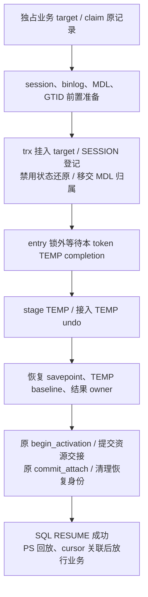
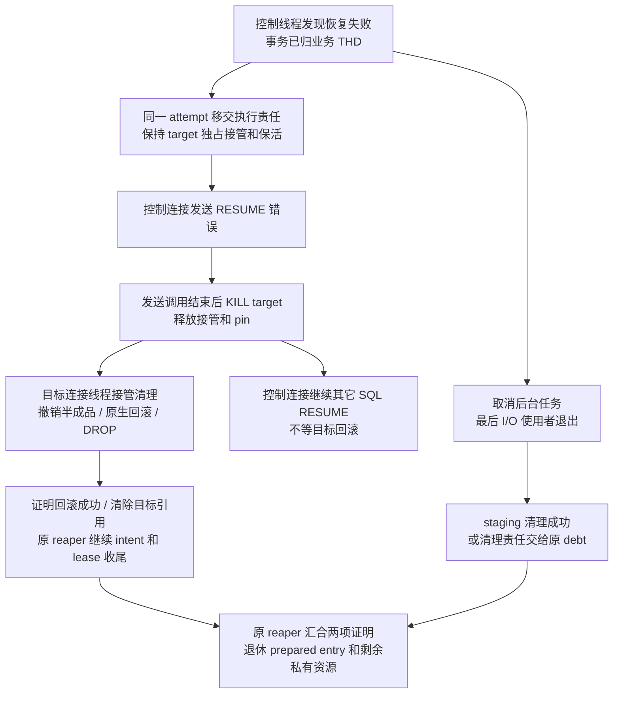
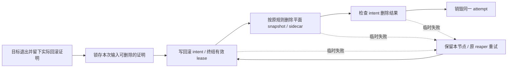
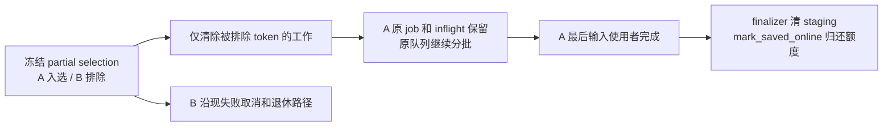

# Receiver TEMP 异步完成与 RESUME 失败收尾：聚焦修复方案

2026-10-12；源码基线 `ha_preserve_trx / 75be6a9eab30847dc5978d290b2d4d4314f9f0a5`。

**状态：2026-10-12 R1–R6 本工程内核修复已完成，新增 21 个 MTR，旧版 RED 与阶段性 GREEN 已保留；最终 Debug 全量 no-bin/log-bin（含 big test）均无失败。实际结果与外部集成边界见 §9。** 本文统一此前六项发现。本轮按用户要求将 R1 明确限定为物理复制工程的独立控制 session：控制线程直接操作业务 target THD；先向 proxy 发送 SQL RESUME 错误，再由服务端主动 KILL target，目标连接线程承担回滚，proxy 只是兜底。同会话 RESUME 不是本次修复对象，保持现状。此前“先 KILL 再响应”及“控制线程同步回滚后才返回”的方案均被本版替换。旧 E128 验证结果不能证明这些异常组合已经覆盖。

§2 的缺陷和源码行号对应上述提交的实施前基线；§3–§8 保留修复规则、预算与完整验收规划，不表示所有计划交错都有独立运行证据。§9 为本次补丁的实际实现及回归结论。同版 Release 已追加 500 连接两轮、TPC-C128、只写1000、M1–M12全矩阵和 mixed-transfer；功能、性能与跨工程集成分别判定。

## 1. 要解决什么，范围到哪里

READY 允许 TEMP 的部分准备和实际 I/O 留在原 receiver worker 中继续执行。基线成功路径已有 completion 和最后使用者保护，但 partial、取消、RESUME 失败及分配异常没有全部接到正确的终态；本轮沿下述规则补齐，实际验证见 §9。

修复目标是：入选的工作能继续；失败的事务不会成为无人负责的 detached owner；真实 I/O 使用者退出后资源能退休；调度分配失败不会杀进程或留下无人执行的 inflight。

- 仅覆盖物理复制工程的 standby transfer → 同一 receiver 进程在线升主 → **独立控制 session 执行 SQL RESUME，直接操作业务 target THD**。请求的 `caller_thd != target_thd`；三个既有升主入口、`Sql_cmd_resume_preserved_transaction::execute()` 入口和已有目标接管合同不变。
- R1 的挂载调序及失败收尾只用于上述控制请求。同会话直接 RESUME 保持现状，不为它新增同步回滚分支、自保活兼容或另一套失败流程；只做已有行为的回归保护。R2–R6 仍修复同一 standby receiver 流水线中的任务与资源问题，这些工作不依赖某次 RESUME，可能在 READY 前后及 RESUME 后继续，不能用是否已有控制请求作为 worker 准入条件。
- 服务端在已接管 target 的恢复失败后，先通过控制连接发送 RESUME 错误，再主动发起目标 KILL_CONNECTION；目标自行退出并回滚，不以 proxy 发起断连为前提。proxy 关闭业务前端并兜底后端，不重试、不回池、不继续 PS 回放。控制连接发起 KILL 后继续其它 session 的 RESUME，不等待该目标事务回滚；响应发送失败／控制断连仍须触发目标收尾，不能等待永远无法送达的错误包。
- 不新增线程池、回滚队列、协议、参数或外部升主阶段；复用现有 teardown 前后接点，在原生错误响应发送后发起待处理 KILL，在原生 rollback 调用处回报实际结果，均为有条件的薄接点。不恢复 PS 本体迁移，不扩展 local startup、RESET DRAIN 或 HA 控制连接策略。
- 保留原预算、并行 worker、分批轮转、BASE＋DELTA、ID 隔离、冻结身份和成功 activation 校验。READY 不等待 TEMP 全部 I/O；成功 RESUME 仍等待本 token 的真实完成。

## 2. 六项问题的统一裁决

| 编号 | 源码确认的缺陷 | 触发及影响 | 修改位置 |
| --- | --- | --- | --- |
| R1 | TEMP 等待失败后，原事务被恢复到不可重试／隔离的 detached 记录，缺少正常回滚归属 | 晚期写入失败、取消或超时；proxy 关闭业务连接也清理不到未挂载的原事务及锁 | `preserve_trx.cc` 的 shared prepare／strict resume；`promotion_prepared.cc/.h` 的失败终结 |
| R2 | partial selection 发布后按整个 epoch 清队列和 inflight | B 失败，A 入选但 TEMP 尚未完成；A 的尾部也被取消，导致 A 无法 RESUME | `transfer.cc` 的 selection publisher／queue purge |
| R3 | staging finalizer 和 reaper 只承认全量 `bound` | partial selection 中成功的普通／RESULT-only token 也不能正常释放 staging；成功升主后无法再依赖 accepted epoch 过期 | `transfer.cc` 的 finalizer／epoch 枚举／任务终结 |
| R4 | ordinary object 在建立 finish guard 前检查取消并返回 | ABORT 与 record-lock/binlog 任务交叠，遗留 inflight，自动空闲停池被阻止 | `transfer.cc` 的 object runner／收尾 |
| R5 | 调度分配位于异常保护外，析构回调内又执行可能抛异常的工作 | 实际 C++ 分配失败可逃出线程入口或 `noexcept` 析构，终止 mysqld | `transfer.cc` 的 worker dispatch／object、binlog finish guard |
| R6 | 先登记 inflight／attempted generation，再分配队列节点，没有整体回滚 | 第二次分配失败后没有真实任务；正常重入被误判为已有工作 | `transfer.cc` 的 enqueue |

R1–R4 不要求系统 OOM。R5–R6 要求实际分配异常，配置预算拒绝不能替代复现。R4/R6 的残留可能被后续整 epoch 清理或关闭清掉，不能描述成所有情况下永久泄漏。旧代码 RED、阶段性修正与最终 GREEN 分别保留在 §9 的验证报告；不把所有规划组合都宣称为已复现。

关键依据：`preserve_trx.cc:25017,26231,26260`；`promotion_prepared.cc:2603,2975`；`transfer.cc:6344,6446,17652,18498,18533,18970,19415,19459`。行号对应上述基线，后续以函数名定位。

## 3. R1：先使业务 THD 具备完整回滚能力

### 3.1 选定方案及“充分挂载”的定义

**唯一调用合同：请求 caller 是控制 session，target 是业务 session，二者身份由物理工程现有控制请求明确提供。** 在进入目标执行上下文前固定真实 caller、target 和本次 attempt；复用已有独占接管及保活。不能用函数执行时的 `current_thd != target` 临时判断是否启用修复：现 strict 入口及 TEMP/RESULT 安装有目标上下文要求，物理工程可能在控制线程中临时切换上下文，这不改变请求 caller。底层恢复沿既有目标上下文执行，返回控制请求前恢复调用方环境，响应与待处理 KILL 记录仍归真实 caller。不因本方案删除 `current_thd == target` 校验，也不另造 TLS 切换机制。

修复启用点只设在现有控制请求进入 strict 恢复的位置：校验明确的 caller/target、接管与存活条件，预留本次失败收尾上下文，再传入现私有 prepare options。后续以该上下文是否存在采用本方案；只有 `STRICT_PROMOTION` 标志不足以启用。没有该控制上下文的现有调用继续原顺序和失败处理，不在各层反复判断会话相等性，也不创建第二套同会话收尾实现。

选定 **控制线程充分挂载 target，失败后移交收尾责任，先发送 RESUME 错误，再主动唤醒/断开 target；目标连接线程沿原 `THD::cleanup()` 执行 `trans_rollback(this)`**。所有资源操作针对业务 target；响应和诊断属于控制 session。传入 `target` 指针不会自动切换执行线程，在控制线程调用 `trans_rollback(target)` 仍会阻塞控制线程，因此不采用。

异步只意味着控制线程不等待回滚，不能把 KILL 已发出写成事务已回滚。基线已有 `preserved_trx_begin_external_thd_teardown()`／`end_external_thd_teardown()`，但缺少回滚成功回报；本轮复用这两个接点，在原 rollback 调用处补结果回报，收尾上下文按精确 target 归属。它不调度任务，真正执行者仍是 target 原连接线程。

进入 TEMP 等待前必须满足：

1. 既有 session、binlog、MDL 和 GTID 前置准备完成；要求 detached 的 `trx_preserve_prepare_resumed_rollback_gtid()` 留在 attach 前。
2. 有事务时 `trx_preserve_attach_to_thd()` 已将同一个 trx 置为 ACTIVE，绑定 target、加入 MySQL trx list、登记 SESSION handler；不能只有 `trx->mysql_thd` 指针赋值。
3. attach 成功后立即禁止 `Resume_thd_state_guard` 还原连接初始状态，并恢复业务事务标志。该 guard 的 autocommit 恢复可能触发提交，不能等 TEMP 失败返回后才禁用。
4. target 已克隆 MDL；不再允许恢复为 detached 可重试记录，因此删除旧 detached MDL backup。锁仍由 target 的 MDL context 保持，避免断连释放了 target 锁却留下 backup 锁。
5. binlog manager 已挂到 target。现 attach journal 保存在可移交的 runtime 内，成功时仍在原 activation 段提交，不提前放宽 registry 成功门槛；失败时交 target 显式处理，不能留在控制栈上析构并静默清空回滚登记。

第5项使用**一个预先分配的 attempt 原位持有 record、现 `Preserved_trx_resume_runtime`、lease、稳定 key/intent 及收尾进度**。在首次改变 target／claim 前准备好对象、拥有节点和 caller/target 索引；两个索引只定位同一对象，不另存两份 journal。成功时正常移除登记；失败只移交执行责任，runtime 留原位。binlog journal 只有 noexcept 移动构造，禁止移动赋值，不能设计成失败时整体赋值搬移 runtime（`binlog_preserve_prepared.h:229`）。

复用现 THD pin mutex 保护拥有节点和索引，不把 attempt 的生命期塞进 pin count map：最后 pin 归零会删该键，attempt 还须活到 target 退出或文件收尾完成。只按真实 caller/target 对象和完整 attempt/key 身份匹配，不按可复用的连接 ID 猜测；控制、目标及 reaper 同时最多一个执行者。OOM 时不再创建失败记录、复制 journal 或批量收集节点。end 撤销全部 THD 索引；继续存在的同一节点只含稳定收尾信息，见 §3.5。

新登记也必须覆盖早退：预留失败尚未改变目标，直接返回；claim/begin_attach/take_record 或 attach 前准备失败，沿原 pre-boundary unwind 归还原记录/资源并撤销本次索引和 pin。若原路径确认 tainted，保留原隔离合同，不伪装成可重试。**尚未跨目标接管边界的失败不进入新增“回滚后文件重试”。** intent 文件名按 key/generation 派生，不含 SQL attempt；旧 lease 已归还为 ADOPTED 后，后台删旧 intent 可能误删下一次 RESUME 的凭据。未取得 lease 的请求更不能清同 key 文件。本次不扩大这条既有早期失败合同；所有新预留仍须退出或明确隔离，不能等待不会发生的 target teardown。

控制请求这一切片须有一个显式异常边界，覆盖**首个新拥有节点/索引发布后到正常退出**：begin_attach 之前的 intent 写入、prepare 的错误字符串及 activation 的 key 复制均可能抛异常。按 lease/claim/takeover_completed 分流，未取得 lease 只撤本次新登记，接管前沿既有撤销，接管后无分配地标记目标收尾，不能只等函数返回错误码；析构 guard 只改既有标志/回退未提交登记，不做 I/O 或构造错误字符串。接管后 binlog commit 失败也须在现同步 abort/cache reset 段**之前**分流，让目标线程执行；只替换 post_boundary_failure lambda 仍会让控制线程承担重收尾。同 THD 的原分支继续保留。

现有 InnoDB 已支持：`trx0preserve.cc:2980` 的 attach 真正进入 ACTIVE；`trx0temp_preserve_import.cc:718` 的 TEMP undo 安装接受 ACTIVE。无需修改原生 InnoDB 状态判定或断连入口。

### 3.2 成功顺序

只改变已登记控制请求的 strict promotion 顺序；现同会话 strict RESUME 和 local durable 路径保持原样。`resource_only` 没有 trx，不制造虚假事务；在 target 接管 session/MDL 后建立同样的不可重试资源边界。

`prepare_resume_on_current_thd_shared()` 仅对上述控制请求将 `wait_temp_ready()` 移到 target 接管点后，将 TEMP stage/undo 保留在等待之后；不得对所有 strict 调用无条件改序。私有 options 引用已预留的控制请求上下文，并携带原 `Resume_thd_state_guard` 的调用期间引用／指针，在 attach 线性化点立即 `dismiss()`；栈上 guard 指针不进入异步收尾上下文。用已有 runtime 的接管完成标记覆盖 resource-only，防止失败处理误走旧恢复记录分支，不引入通用 callback 层或额外运行模式。

savepoint 必须留在 TEMP undo 安装后：导入校验使用最终 `undo_no`，TEMP undo 会调整这个上界。成功仍须完整验证 TEMP/result 交接，不能把 `begin_activation()` 改为接受未取得的 TEMP，也不能提前返回 SQL OK。

### 3.3 控制线程先发送错误，再发起断连

适用范围是已登记控制请求中，业务 THD 已接管后的 TEMP 等待、stage、undo、savepoint、结果安装和 activation 失败。原事务不能再次 detach。控制线程在 target 独占接管及保活期间完成：

1. 取消本 token completion；dismiss 会还原 autocommit 的 state guard，保留业务事务上下文。
2. 将预留 attempt 标记为等待响应后的目标收尾，record/runtime/journal/lease 留在同一对象中，不再搬移或复制。控制栈不得另持仍会自动 abort 的同一 journal，也不得把栈 guard 地址留给目标。已消费的 lease 不恢复，尚未消费的 lease 继续保持 ATTACHING／ACTIVATING，由该 attempt 独占，阻止重复 RESUME。
3. 发布目标收尾上下文，控制侧保留待处理 KILL、精确 target 保活和既有独占接管，设置控制 session 的错误诊断并从 `execute()` 返回。此时不能 KILL，也不能恢复 target 的业务可执行状态；相关责任必须移出 SQL 执行栈，不能随函数返回析构。
4. 由正常响应路径发送错误。在 `THD::send_statement_status()` 的 `DA_ERROR` 分支、`m_protocol->send_error()` 返回后，通过窄条件 hook 按控制 THD 与本次命令／attempt 身份，锁内一次性认领待处理记录；解锁后再持 `LOCK_thd_data` 调 `target->awake(KILL_CONNECTION)`，控制 session 不被 kill。只处理已登记的本次失败 RESUME，不能由下一条无关错误触发，不改变普通错误、成功响应及 DA/is_sent 语义。仅写 `target->killed` 不足以唤醒 socket 等待者；不能因已置 killed 就省略尚未发送的唤醒。
5. 领取时在原 pin mutex 内清 caller 索引，**仅将接管释放句柄和 target pin 移到控制栈局部**；解锁后发起 KILL，再释放接管，最后释放局部 pin。此后既不能访问 target，也不能访问 attempt，目标和 reaper 可能立即销毁它们。最后 owner/pin/journal 析构必须在 pin mutex 外，pin 析构会再次取该锁。控制线程继续下一条请求，不调用 `release_resources()`、`trans_rollback()`、TABLE 批量关闭或线程 join；后续诊断只使用领取前固定的稳定信息。

**“返回错误”以服务端错误包发送调用完成为界，不是仅执行 `my_error()` 或 `execute()` 返回。** 本地调用链为 `dispatch_command()` → `THD::send_statement_status()` → `Protocol_classic::send_error()` → `net_write_command()`，最后包含 `net_flush()`（`sql_parse.cc:2356`、`sql_class.cc:2557`、`protocol_classic.cc:1340`、`sql-common/net_serv.cc:901`）。发送成功不证明 proxy 应用已经读取；控制连接错误包和目标连接关闭跨两个 socket，不能承诺 proxy 的观察先后，也不新增接收确认协议。

发送失败时，在发送调用返回后照样发起 KILL；控制连接在发送前退出、未走到正常发送点时，由既有 control teardown 接点消费同一待处理记录，再继续自身 teardown。两个入口只允许一个领取，禁止重复移交、重复释放 pin；兜底也不做同步回滚。网络发送沿现有写超时，不为了等待 proxy 接收而无限保留 target；此异常路径不能声称已成功送达错误。特别是 `net_send_error_packet()` 在无 VIO 时也返回 false（`protocol_classic.cc:1210`），不能仅凭返回值统计“已经发送”；无有效 Classic 连接属于断连兜底，仍须 KILL。既有 GTID `notify_after_response_packet()` 职责不变，不把该接口改为通用清理回调。

同一 attempt 的控制责任阶段保留外部 target pin 到 KILL 发起之后；领取后 pin 归控制栈，**目标执行收尾时 attempt 不再持该 pin**，否则原 `begin_external_thd_teardown()` 等 pin 归零会自锁。登记沿现 pin mutex 保护，但网络发送期间不持 pin mutex、`LOCK_thd_data`、registry 或 pool mutex；保留的是接管资格和保活引用。control teardown 先处理其待响应记录、释放 target 的 pin，再进入自身 pin 等待；新登记仅接受已验证的不同 caller/target，不产生自身 pin。target hook 在 pin 归零且解锁后才访问上下文、执行 journal/I/O。保活 pin 仅防止销毁，业务执行、RESET、PS 回放和其它控制请求仍须由物理工程既有独占接管机制排除。外部并发 KILL／网络断开可以先发生，不能把“本次 RESUME 不提前发起 KILL”写成禁止其它断连原因。

### 3.4 目标连接线程执行真正的收尾

target 的原事件循环被唤醒后退出，进入 `release_resources()`。复用其 begin/end teardown 接点；仅命中该控制请求预先发布的精确 target 上下文时执行新增收尾，没有登记则沿现有逻辑返回。begin 的两个现有分支均须在 pin 归零并解锁后处理已发布的失败上下文，不能保留其中一个分支直接 return 而漏清理。目标线程按以下顺序执行，控制线程不等待：

1. 终止本次恢复，不重新 detach，不将原事务放回 `g_preserved_trx_records`，不重试该逻辑 session。
2. 取消本 token completion。未安装的 worker 私有 owner 仍由最后使用者结束后退休，不关闭运行中的 FD，不等待其它 session。
3. 未提交的 result journal 用现有 rollback 撤销；凡已建立 TEMP Attach、但尚未 native handoff，均同步 `Attach::rollback()`，包括 TABLE 已链接但 undo 尚未接入的部分失败。正常收尾先撤销 undo 对 trx 的借用，再进行原生回滚/free；不将仍借用 trx 的 plan 放入后台退休队列。若撤销无法证明成功，先按 §3.5 永久隔离所有可能再访问借用指针的对象，再继续既有 target teardown；不把隔离当作撤销完成，不认可成功回滚/所有权证明，也不进入正常 reaper。
4. 未提交 binlog journal 用原 abort 逻辑收尾。**abort 会清 SESSION/STMT scope**，所以复用现 `post_boundary_failure` 中“保存精确 InnoDB handlerton → abort → 验证仍为同一 ACTIVE attached trx → 重新登记 SESSION 并标记 read-write”的代码，不能只 abort。abort 成功后清 attached 标志、reset detached handle，不放回 registry；resource-only 不执行虚假的 trx/handlerton 校验。已提交的 binlog cache 留给原生回滚处理。
5. 已 native handoff 的 TEMP 在前置收尾中仅 `finish()` 解除安装 journal 对 TABLE 的引用；表和 undo 留在 target。结果安装记录中的私有 owner 同样在 target 清理，不能留下已释放 TABLE 的 journal 等 end 时再检查。
6. 复用 `reset_preserve_statement_transaction_scope(target)` 清 STMT，保留 SESSION，随后返回原生 cleanup 流程。由现 `THD::cleanup()` 按“唯一一次 `trans_rollback(this)` → 释放事务 MDL → close_temporary_tables → 已交 THD 的结果 owner 清理”执行；不在 begin hook 重复 rollback，不再调用 `drop_after_rollback()` 重复 DROP。GTID 随原链处理，不能提前撤销其归属；KILL 本身不是跳过回滚的理由。
7. 在原生 `trans_rollback(this)` 调用处记录其实际返回值，通过有条件、无分配的薄接点写入同一 attempt，不另建回滚记录系统。end 只确认前置撤销、真实回滚及借用结束的证明，清 THD 索引和指针，并把同一对象标记为可由现 reaper 继续稳定文件收尾；控制和目标线程均不重做原生 rollback。实际回滚、所有权检查失败或缺少回报保持明确隔离，不伪报成功。文件阶段与普通 I/O 错误重试见 §3.5。

end teardown 位于 `ha_close_connection()`／`restore_globals()` 之后，不能再访问保存的 `trx*`、TABLE 或假设 target TLS 仍有效；只能使用先前回报及稳定 key/lease。已 `commit_attach()` 的晚期失败没有活跃 lease，原事务由同一目标断连路径清理，不调用 `finish_rolled_back_attach()`。目标是否从线程管理器消失、`killed` 是否置位、proxy 是否看见断连，都不能代替回滚证明。回报还必须结合前置确认的同一原事务及完整 SESSION 登记，不能把“空事务 scope 回滚成功”当成原事务已回滚；缺少回报一律不认定成功。已登记的收尾责任不可因随后开关改变被忽略；物理工程的静态总开关沿现合同隔离。

**“撤销未完成挂接”是撤销本次资源安装的半成品，原事务继续归业务 THD；不是把整个 RESUME 倒放、重新 detach 事务。** journal 是本次安装已执行到哪一步的内存记录；资源 `commit()` 表示所有权交接完成，不是 SQL COMMIT。按失败时的实际进度，只执行对应动作：

| 当时已有的状态 | 具体动作及现有入口 | 动作后的归属 |
| --- | --- | --- |
| 只在等待 TEMP completion，尚未 stage | `completion.cancel()` 标记取消并唤醒等待者；不关闭正在使用的 FD、不清 PENDING，不调用不存在的 TABLE/undo 撤销 | worker 保持私有 owner，实际 I/O 返回后结束任务；事务已在 target，可独立执行原生回滚 |
| TEMP TABLE 部分打开／链接，尚未 native handoff | `TEMP Attach::rollback()` 校验本次安装对象，按 slot 逆序：已链接 TABLE 的 `tmp_table_def` 退回私有 DD owner，`close_temporary_table(..., delete_table=false)` 解链并关闭；仅打开未链接的 TABLE 调 `intern_close_table()`；注销本次 TEMP handler 映射；清 SQL-bound，返回私有 owner | 不执行原生 DROP，不触碰同 receiver 其它 session 的临时表；私有 owner 退役处理 |
| 上一行还已经接入 TEMP undo | 同一 `rollback()` **先**调用 `rollback_target_undo_attach()`：验证同 trx/undo 身份，把导入的 noredo undo 退回 plan 的 scratch owner，恢复本次安装前的 `m_noredo`、`undo_no`、`undo_rseg_space` 和语句 undo 起点，清 plan 借用的 trx 指针；然后才关闭 TABLE/注销 handler | 只撤销 TEMP undo 安装，永久表 redo undo、trx 与 THD 的绑定、事务锁仍保留；不能先 free/rollback trx，再让 plan 访问旧指针 |
| 结果 owner 已 stage，但尚未交给业务 THD | 未 committed 时 `RESULT Attach::rollback()` 仅把 owner 从安装记录移回局部 Ready，随后释放；它不回放 SELECT、不重建或删除 PS。即使已 `commit()`、尚未 `finish()`，owner 仍在安装记录中，由原失败收尾 reset 释放 | SQL RESUME 未成功，PS 回放／cursor 关联尚未开始，无需执行一遍 PS 解绑；结果内容不恢复成可重试 token |
| binlog cache 已 attach，但 journal 尚未 commit | 调现 abort 收回 cache manager，清 attached 标志并释放返回 handle；abort 同时清了 SESSION/STMT，所以必须验证原 trx 仍挂在 target，重登精确 InnoDB SESSION 并标记 read-write；resource-only 跳过 trx 校验 | 不把 cache 放回 registry；原事务继续能由 `trans_rollback(target)` 处理，已 committed 的 cache 不走这条 abort |

上表所有循环关闭、owner 析构、cache 释放均由目标线程执行。TEMP 若已完成 native handoff，不能再调用 `Attach::rollback()` 把 undo 取回；先 `finish()` 解除 journal 的 TABLE 引用，再交原生 cleanup 回滚及 DROP。原事务的 THD 归属、SESSION 回滚登记及所需 MDL/GTID 上下文必须保持到原生回滚；不得执行旧 `pre_boundary_failure` 中的重新 detach、提前释放 MDL、恢复可重试记录或恢复 autocommit 的整套动作。

动作依据：[TEMP 安装撤销](/Users/a1234/project/mysql-server-8022-preserve-port/sql/preserve_trx_temp_restore.cc:386)、[TEMP undo 安装撤销](/Users/a1234/project/mysql-server-8022-preserve-port/storage/innobase/trx/trx0temp_preserve_import.cc:272)、[结果 owner 撤销](/Users/a1234/project/mysql-server-8022-preserve-port/sql/preserve_trx_result_restore.cc:171)、[binlog abort](/Users/a1234/project/mysql-server-8022-preserve-port/sql/binlog.cc:2008)、[断连原生回滚](/Users/a1234/project/mysql-server-8022-preserve-port/sql/sql_class.cc:948)。本轮已复用这些现有动作接入提前挂 THD 的控制恢复失败路径；执行证据与边界见 §9。

`rollback_attach_after_activation()` 狭义改为内部 `finish_rolled_back_attach()`，接受当前 lease 独占的 ATTACHING 或 ACTIVATING；调用前必须已执行并证明原生回滚，resource-only 则证明没有事务且安装对象已撤销。保留 key/generation/lease 认证及 intent 顺序，不调用 `abort_attach_after_full_unwind()` 使失败 token 重新可用。

该方法不能只改变状态：当前 `ATTACH_ROLLED_BACK` 没有正常资源回收分支。但也不能先移出整个 `resources.m_impl`、留下空 entry：snapshot 的 pending 来自这个对象，移走会把仍有 I/O 的任务误报为不再 pending。**回滚终态保留原 entry、completion 和精确身份，直到 pending=false，且 staging 已清理或已有可靠的 cleanup debt。** 此后才由原 reaper 锁内移出 owner、锁外退休。取消不等于最后使用者退出，不能提前归还额度。

只在现 prepared entry 增加同代单向布尔标志 `staging_cleanup_owned`：§4 的 finalizer 完成交接后置位；初始、改变 key/generation 或实际安装新代资源时为 false，同代幂等发布不清除。对 `ATTACH_ROLLED_BACK` 和 `ACTIVE_ARTIFACTS_CLEANED` 的身份退休，`expire_once()`、`purge_token()`、`purge_epoch()` 共用 `!temp_preparation_pending && staging_cleanup_owned` 门槛，且继续保留原 physical pin、live/ambiguous owner 检查，防止绕过 reaper 直接 purge。

**正常 ACTIVE 的重资源释放保持原样，只延迟轻量 entry 的删除。** 当前 `snapshot()` 在重资源移出后仍返回 publication 的完整 key/facts/state，finalizer 可据此补交接；通知必须接受这种同代 `ACTIVE_ARTIFACTS_CLEANED`。不把新门槛扩散到 NOT_READY 等无本次交接责任的原有状态。不借用 `begin_cleanup()/commit_cleanup(true)`：它们只接受 ADOPTED_LOCKED/ATTACH_TAINTED，且会直接移空资源、丢失 pending 证明（`promotion_prepared.cc:2640`）。

两条收尾可以并行；事务回滚无需等待整池 I/O，但 prepared 证据的退休必须等本 token 的最后使用者退出。图中 S 发送失败仍进入 K；控制连接提前退出则由其 teardown 接点兜底执行 K。原生回滚或所有权校验失败时仍按上述隔离规则处理，不能越过证明步骤。

### 3.5 回滚已完成后的稳定收尾：同一对象、原 reaper

新核实的缺口：`rollback_attach_after_activation()` 写 intent 失败返回时 lease 仍有效；若随即析构，`fail_closed()` 转为 TAINTED 并丢掉 lease，而现 reaper 没有补写消费者。`remove_strict_attach_intent()` 还忽略删除结果。普通 I/O/OOM 不能直接变成永久隔离，也不能静默丢掉清理责任。

最小处理复用 `preserved_trx_expired_reaper_scan_once()`、现线程及 `request_scan()`。对前置撤销成功的正常收尾，target end 撤销 caller/target 索引，清 `record.trx`、THD/TABLE/journal 借用、TLS/栈引用、pin/接管句柄；所有会访问目标的 journal 必须已在 begin 处理。原 attempt 仍在同一拥有容器中，留下稳定 key、必要 metadata、lease、回滚证明及已完成步骤：

图中重试从**尚未完成的步骤**继续，不能重做事务回滚、已消费 lease 的终结或资源 DROP。已 commit_attach 的晚期失败跳过 lease 步骤。一次原锁内认领一个到期节点，锁外执行 I/O；异常时无分配地撤销执行标志，保留同一节点并用现调度重试，不构造 vector 批次、不另建队列。重试期间 ATTACHING/ACTIVATING 的唯一负责人是该节点，不是无人执行的 PENDING。

输入证明按两条现有所有权路径取得，**不能把 registry NOT_FOUND 当作清理安全证明**：

- lease 仍有效：通过按精确 key 的无分配查询，确认 `!temp_preparation_pending && staging_cleanup_owned` 后锁存到 attempt，再写 intent/消费 lease。状态仍 ATTACHING/ACTIVATING 时原 purge 禁止退休；后续文件失败不再依赖可能已退休的 entry。查询复用现 entry 锁，不复制 snapshot 的字符串。
- `commit_attach()` 已成功返回：立即锁存 `resource_handoff_proven`，不能用 `!lease.active()` 代替。该函数验证已 take/committed_matches，且 `take_temp_ready()` 要求实际准备完成（`promotion_prepared.cc:1443,2515`）。目标完成回滚及安装 owner 收尾后，平面 token 工件可沿原成功路径的证明删除，无需重新找到 entry。`.transfer/epoch/token` staging 独立由 §4 finalizer 处理；正常成功路径同样不等待 staging_saved 才删平面 snapshot（`preserve_trx.cc:26392`）。此分流省去新的 registry pin 或长期引用句柄。

复用现 intent writer、狭义终结，以及 strict 成功路径的 `delete_snapshot_files_with_status()` 删除平面工件：它按文件处理缺失，可在部分 unlink 后重试；目标 ID/undo 归属仍由本次 receiver plan/native owner 负责。**不把 metadata-aware 的 `delete_preserved_snapshot_files_and_sidecars_or_log()` 直接放进重试循环**：后者先读取全部 undo sidecar 再逐项删除，部分删除后再次读取可能因前一个文件缺失而永远失败，还混入源端 reservation 处理。故本轮不改 temp_table.cc。intent 删除改为返回可检查结果，原同会话调用可继续忽略结果而不改其行为。

不能复用 receiver 的 `Cleanup_debt` 承载事务收尾：它只拥有 staging 目录、额度等，且现有有界重试后会 taint；把 lease/journal 塞入其中会扩大职责。删除必须服从上面的精确输入证明，不能只因事务回滚成功就删。

真正的事务回滚失败、身份/CAS 不一致、借用撤销失败保持既有 fail-closed/隔离边界，不能当作普通文件失败重试。隔离必须保留实际未解除的 owner/journal，不能只留清了 `trx` 的 observable record；TEMP 复用现 quarantine。binlog active journal 没有 quarantine API，其析构会再访问 target 并断言：若目标尚存活时显式 abort 已无法证明所有权，将**同一个 attempt 标记为终止隔离**，移除 THD 索引、释放 pin/接管后，锁外对拥有指针 `release()`，原位保留未决 journal/lease/额度至进程退出，不新增隔离队列，也不让全局容器退出时析构它。其内部指针永不再访问；不得交普通 reaper 或伪称清理成功。该极端分支沿现 TEMP/binlog 的保守隔离原则，不新增原生 binlog 接口。

隔离不是自动完成，测试必须分别报告。所谓闭环，是正常及临时失败恢复后有唯一执行者并可收敛；不宣称持续 OS 故障或未知所有权能强制清理成功。

### 3.6 失败矩阵与并发边界

| 失败时位置 | 原生事务 | TEMP 与结果的处理 |
| --- | --- | --- |
| TEMP I/O 尚未完成，等待失败 | 已在 target；服务端主动断连，由目标线程原生回滚 | 取消 completion；后台结束当前批后退休 private owner |
| TABLE stage 部分完成，undo 未接入 | 同上 | 目标连接线程内撤销已链接 TABLE/handler；未接管 owner 退休 |
| TEMP undo 已 ATTACHED，native handoff 未完成 | 目标连接线程内先撤销 TEMP 借用，再 rollback | 先把 undo 从业务 trx 退回 plan；不能让后台访问已释放 trx |
| TEMP native handoff 已完成、lease 尚未消费 | 原生 rollback 处理当前 redo/noredo | 已交接的 undo 不再归 plan；回滚后关闭／删除该 session TEMP |
| `commit_attach()` 已成功，随后清 runtime identity 失败 | 沿现有 THD-owned KILL/断连路径回滚 | lease 已消费，不再调用回滚 lease 终结接口，不使 token 可重试 |
| resource-only | 无 trx，不伪造事务回滚证明 | 服务端终止 target，目标线程撤销 session 资源；剩余 private owner 退休 |
| 实际回滚成功，intent 写入／工件删除／intent 删除暂时失败 | 原事务不重做 rollback | 同一 attempt 由原 reaper 从未完成步骤重试；不丢 lease/证据、不保留失效 THD 指针 |
| 真实所有权不明／撤销或回滚失败 | 不重新 detach、不伪称已释放锁；保留目标归属及现有隔离证据 | 服务端仍主动终止 target；禁止释放未知 owner，单列失败证据 |

等待只持 completion 引用，不持 registry entry、pool 或 InnoDB 全局锁。控制线程必须先完成失败责任移交，经过错误发送并发起 KILL，才释放独占接管和 pin；等待发送期间 target 不能恢复执行，之后也只能进入清理，不能并发开始 FETCH/RESET。后台 TEMP worker 操作私有 plan，不借用业务 trx；已借用 trx 的安装 journal 只能移交给同一 target 的清理线程，不能投给通用 receiver reaper。成功 RESUME 仍可能等待本 token TEMP 完成；本方案消除控制线程承担的失败回滚，不承诺把成功恢复也改为异步返回，更不能在 TEMP 未完成时返回 SQL OK。

当前仓库 `Sql_cmd_resume_preserved_transaction::execute()` 直接传入自身 THD（`preserve_trx.cc:26026`），不是本次新增失败收尾的启用入口；保留该入口现状。物理复制工程已有跨 target 请求路由负责提供控制调用身份和接管条件。本方案不新增跨 session SQL 协议，也不把现 strict 的 `current_thd == target`（`preserve_trx.cc:26114`）当成请求 caller 等于 target。集成须核对既有执行上下文、控制诊断归属、pin/独占、目标原执行线程的唤醒及 teardown 接点；外部源码不可访问，不宣称本地已验证这些接线。

## 4. R2＋R3：部分成功必须保留成功任务，并完成 staging 收尾

### R2：清理按 token 选择，不销毁后重建

- 扩展现 `purge_receiver_epoch_prewarm_queues()` 的内部清理范围：partial publisher 传入已冻结 `ready_tokens`；全 epoch 取消、过期、关闭仍沿原全清路径。
- 入选 token 的排队节点以及正在执行任务的 staged/object inflight、必要 deferred/done 和相关准备引用保持完整。其它 token 沿现有 splice-to-retired 清理；实际析构在池锁外执行。连同末尾的 epoch 级 binlog prepared 清理一起按范围核对，不能前半段保留、后半段又清光。
- selection snapshot 在进入 pool 锁之前固定。保持既有 pool → ready 检查锁序；不在持 ready 锁时再取 pool 锁，不在锁内等待 I/O 或 join。
- 当前“已分类禁止新任务”检查只覆盖 staged 分支，须在同一 pool → ready 锁序下补齐 ordinary object 准入；不能把它描述成源码已有全覆盖。否则 purge 撤掉被排除任务的 inflight 后，新同 key 任务可能进入，被旧 worker 的首次 finish 擦掉。seed 包装器在 enqueue 前建立的 QUEUED 也须随拒绝撤销，不能机械返回 OK 留下虚假状态。成功 TEMP 尾部沿原节点 `splice` 继续，不重新准入；不销毁再重建 work/completion。
- 不改 ready selection 结果，晚期 TEMP 失败仍由该 session 的 RESUME 拒绝，不能回写 epoch 分类或迟到成功。

### R3：以“本 token 入选且最后使用者已结束”清理

- finalizer 的全量 `bound` 判断收敛为：原全量 bound，或者同一冻结 epoch 的 partial selection 已发布且本 token 在成功结果集合中。继续核对 token/final 身份，不把整个 partial epoch 设成 bound。
- reaper 枚举范围相应纳入已发布 partial selection 的 epoch，再由同一 token 谓词筛选；复用已有冻结结果，不新存一份选择清单或启动扫描线程。
- TEMP 的 pending／最后输入使用者检查保留。SQL RESUME 移走成功 owner、升主移走 accepted epoch，都不能使有效收尾失去依据。
- 任务成功、真实 I/O 错误和取消退出均须在不再读取 staging 后驱动现 finalizer；尤其检查 published-tail 的 cancelled 早退，不能只结束 completion 而漏掉清理。R1 不能提前退休证明来源：若原 job 在登记 cleanup debt 前遇到异常，reaper 仍须通过保留的 entry/completion 继续收尾，不能仅靠 job 最后一次携带的 `published_temp_completed=true`。
- 只沿 `cleanup_transfer_token_staging()` → `mark_saved_online()` 或既有 cleanup debt 归还 reservation/文件引用。失败删除进入原重试路径，不能提前把 reservation 改成零。

清理责任交接使用一个内部、无分配的 `note_staging_cleanup_owned(key)`：finalizer 先取得精确 key，在 `mark_saved_online()` 或 `mark_cleanup_pending()` 成功后立即调用；已经处于相应终态的幂等分支也补通知。通知复核完整 key、generation、有效 publication、未退休和 pending=false 后置位；READY_FOR_GATE、ADOPTED_LOCKED 及重资源已释放的 ACTIVE_ARTIFACTS_CLEANED 等同代状态也须接受此事实，不能仅接受 ATTACHING／ACTIVATING。它不改变事务状态、不执行 I/O、不立即销毁 owner。mark 失败时不置位，entry 继续为 reaper 提供重试依据。

这段通知不能复用会复制 locator 字符串的 `find_prepared_entry()`：利用已有 transparent comparator 直接 `entries.find(key)`，取共享引用后释放 registry 锁，再取 entry 锁复核。当前两个 mark 方法提交状态后无正常分配步骤（`preserve_trx_receiver_retired.cc:281,347`）；通知紧随成功返回，之间不插入日志、key 复制或其它可能抛出的动作。现 reaper 只枚举 sealed RECEIVING，不能指望它事后重新看到 SAVED_ONLINE；因此通知必须在这次交接中完成。cleanup debt 已取得文件/额度的回收责任后，prepared 证据才可退休，不要求磁盘删除已成功。

## 5. R4＋R5＋R6：让调度的取得与释放成对

### R4：ordinary object 从第一个出口就有唯一收尾责任

runner 使用 job 已缓存的 `object_key`，覆盖“已 ABORT／查不到对象／读取失败／异常”全部出口。ordinary/resource runner 中同一 key 的旧 guard 归并到 worker 显式、可捕获收尾；在 pool 锁内首次释放时置“本次 ownership 已释放/移交”，再解锁准入 deferred。否则 deferred 已创建新同 key 任务后，旧 catch 再次 finish 会误删新 owner。该标志不能代替 §4 的分类准入保护，后者还防止旧任务**第一次** finish 误删重入任务。TEMP 分批仍保留原节点、inflight 和 completion，不重复 finish。

### R5：分配和发布在已有边界内配对

| 位置 | 最小修改及不可省的约束 |
| --- | --- |
| worker dispatch | 容量/依赖查找及 active-map/set 登记均纳入现锁内异常保护；登记成功后才 splice 出队、扣 queued bytes、增 active。失败仅按插入结果回退本次登记，节点仍在原队列；释放本轮 iterator/reference，在原 CV 有界等待并响应 stop/shutdown，不新增重试池。 |
| binlog seed | `Preserve_trx_prepared_token_resources()` 会 `new Impl`；key 和 resources 须在 start 置 BUILDING **之前**构造。finish 的默认 retired 对象也会分配，改从已有 resources noexcept move 构造并复用移空槽；guard 只核对预构 key/seed/instance、移动资源或擦除，锁外析构。facts 的 canonical_digest 从本地对象 move/swap，READY 最后发布。保留一个真正无分配的 guard，无需另一套成功/失败框架。 |
| partial classification guard | epoch key 在置 binding 前预构；析构只 find、核对 generation、清本次 binding，不临时复制 pair/string。 |
| record plan 归还 | `take` 已删 map 节点，`put` 会复制 facts 并 emplace；C++14 无 extract。将 take 后主体包成局部立即调用 lambda，使正常早退汇入一次显式、可捕获的 put。只有 put 成功才返回 WAIT/RETRY；恢复失败明确终结本次 prepare，不能吞异常伪报可重试。异常展开保留局部 owner/lease 的既有释放责任，不新增节点租借缓存。 |
| worker finish/catch | pin 保持到显式 finish 和 deferred admission 结束；旧 guard 移除，不叠加第二次 finish。catch 只撤销仍由本任务持有的登记，不能再构造可抛的错误记录。splice 移交后不读旧 job 引用。 |

上述之外，**不能从 finishing catch 对整个 epoch 无条件 purge**。普通/RESULT-only 也可能已发布 partial，不能仅凭 `published_temp_tail` 判断。复用现 ready-state mutex 与字段，明确三步裁决：

1. 预构 epoch key，保证失败记录节点在任务取得责任前存在。锁内确认 `!global_failure`、完成本轮 ready/failed 快照，再置 `binding`、取得 generation；此处冻结本轮选择，尚不等于对外 READY。full binder 的缓存和读 facts 两个准入点、partial、`retry_unbound_receiver_epochs_once()` 及普通新任务准入均检查预发布失败。
2. binding 后的错误只 find 该节点并保留 `global_failure`，不改 token_results、不全 epoch purge。本轮发布失败则原 guard 清 binding，保留失败位供后续准入拒绝及原 expiry/reaper 收尾；本轮成功则依原快照完成，迟到失败不撤销冻结选择。入选 token 在冻结前已有成功准备事实；仍可能失败的入选 TEMP 尾部通过原 completion 使其 RESUME 失败。普通/RESULT-only 在完成准备后发生的日志、finish 等异常只收尾本任务，不据此销毁已经移交的资源。
3. 对外 registry 发布成功后，用预构 key、find 和同 generation 校验完成本地镜像，中间不分配、不日志。full 的 accepted READY 在最终 ready mutex 前已对外可见，不能在最后锁内检查迟到 global_failure 再否决；partial 同理。同一存活 generation 必须完成镜像；若原有 ABANDON、expiry 或关闭已删除节点或使 generation 失效，不重建、不复活，由原终态路径收尾。这里禁止的是 finishing 异常撤销冻结结果，不禁止既有 epoch 生命周期终结。

保留原发布函数对精确 token、prepared 状态和 generation 的验证。不得把缺少成功准备事实的任务按“迟到诊断”放过，也不能把所有迟到异常都称作 TEMP I/O 失败。该方案复用 binding、generation、global_failure 和现清理路径，不新增 registry 状态/选择副本；T9 覆盖冻结前、冻结中失败、发布成功及发布回退四个窗口。

不修改通用 `include/scope_guard.h`，不增加全库异常框架。任务真实异常与正常预算拒绝分开验证。

### R6：保持 enqueue API，仅补原锁内的失败回退

**撤销“所有调用改传单节点 list”的旧方案。** `Receiver_prewarm_job` 移动构造已明确 noexcept（`transfer.cc:17017`）；保留现 `enqueue_receiver_prewarm_job(Receiver_prewarm_job &&)`、包装器和 `push_back(std::move(job))`。队列节点分配失败不会先移走 job，无须适配全部调用或 Debug probe。

原 pool mutex 内保存本次 insert iterator、新增标志和 attempted generation 原值；任一后续分配失败只撤销本次修改。所有登记与 push 成功后才计费和 dismiss，失败 owner 锁外释放。deferred manifest 先完整复制，再 emplace 或 move 覆盖，不能 `operator[]` 留半份记录。job 已 move 后不再读取原 object_key 引用。

binlog seed 包装器的 QUEUED 登记也复用原 map：先预构 key/完整 pending，再 emplace 或无抛出移动替换；返回本次是否创建/替换及 instance。无分配 rollback guard 覆盖其后 job 构造、manifest 复制和 enqueue，只有完整 key/seed_digest/instance 匹配且仍 QUEUED 才撤销**本次**登记。复用他人的 QUEUED/BUILDING/READY 不得删；正常等待 payload 的 QUEUED 仍保留。准入拒绝与去重成功明确区分，不能按 token 无条件 erase 或在回退中分配 vector。

现有 resource/TEMP 续作仍 splice 原节点，不重新取得 inflight；不新增缓存层。资源 manifest freeze 与队列准入分开，不能因入队失败盲目解冻 final 输入。失败返回与上层 seed/registry 登记的撤销成对；有正常重入机会时能真正入队，不能留下虚假 QUEUED/inflight。完整收尾仍驱动原 idle 通知，不放宽停池条件掩盖残留。

## 6. 代码改动预算与禁止扩散的位置

| 文件 | 计划修改 | 边界 |
| --- | --- | --- |
| `sql/preserve_trx.cc` | 已登记控制请求的 strict 调序、guard/MDL 交接；单 attempt 原位持有 runtime/journal；响应后 KILL；复用 teardown、回滚回报及原 reaper 稳定文件收尾 | 控制线程只移交、发送错误与发起 KILL，target 执行重收尾；同会话入口及其原有失败分支不改 |
| `sql/preserve_trx.h` | 登记真实 caller/target 与既有独占接管释放责任；声明响应后收尾和原生 rollback 回报 | 仅包装既有控制请求，不新增跨 target SQL 路由或调度器 |
| `sql/preserve_trx_promotion_prepared.cc` | 狭义回滚终结支持 ATTACHING/ACTIVATING；回滚终态和 ACTIVE 轻量身份共用退休门槛；ACTIVE 重资源正常释放 | 仅一个同代清理交接标志；不放宽成功门槛，不添加 registry 状态 |
| `sql/preserve_trx_promotion_prepared.h` | 同步内部终结接口名／说明及无分配的 staging 交接通知 | 不变更物理复制工程的升主接口或 cursor 关联 API |
| `sql/preserve_trx_transfer.cc` | R2–R6 的 token 选择清理、staging 终结、调度异常安全 | 原 worker/队列/credit/所有权，不新增线程或后台阶段 |
| `sql/preserve_trx_promotion.cc` | ABORT 时实际 I/O 尚有使用者，保留 ABANDONING，由现 reaper 继续 destroy | `RESOURCE_PREPARING` 不误报为所有权损坏；不增加状态 |
| `sql/sql_class.cc` | `send_statement_status()` 的错误发送调用后触发窄收尾；原 `trans_rollback(this)` 记录返回值并回报 | 两条有条件薄接点；不提前／重复发包，不改变普通错误；仍只执行一次原生 rollback |

**当前实现集中在 7 个现有内核文件、0 个新增内核文件，其中 1 个 MySQL 原生文件增加“错误发送后收尾”和“回滚结果回报”两处薄接点。** 这是复用物理工程已有控制路由、目标执行上下文和接管能力的条件预算，其实际调用处仍须对接核实。不为同会话调用新增修复分支，不为响应顺序另改 `sql_parse.cc`，也不在 `execute()` 中手工发包。原4文件预算不再适用于“控制线程不等回滚”的要求。复用 pin 保护和现 teardown 接点，不新增 THD 字段或回滚池。`temp_restore.cc`、InnoDB temp import、`binlog.cc`、`mysqld.cc` 作为复用能力和验证对象，不预先修改。代码行数以实际补丁统计，不把未实现方案写成精确净增行数。

### 6.1 按实际职责核算的内核行数预算

下表是源码逐块拆分后的**配对工程估算**，含必要注释，不是已生成补丁的统计。每档分别计算新增减删除，不用“最少新增减最多删除”拼出偏小值。包括单 attempt/索引、从首个登记起的异常边界、目标前置撤销与回滚回报、原 reaper 重试、prepared 证明与三个退休入口，以及 R2–R6 全部配套；未把仍使用的同 THD 分支计作删除。

| 文件 | 低档：新增 / 删除 / 净增 | 中位计划：新增 / 删除 / 净增 | 高档：新增 / 删除 / 净增 |
| --- | ---: | ---: | ---: |
| `sql/preserve_trx.cc` | 600 / 40 / 560 | 730 / 60 / 670 | 870 / 85 / 785 |
| `sql/preserve_trx.h` | 16 / 0 / 16 | 22 / 0 / 22 | 28 / 0 / 28 |
| `sql/preserve_trx_promotion_prepared.cc` | 100 / 20 / 80 | 125 / 25 / 100 | 150 / 30 / 120 |
| `sql/preserve_trx_promotion_prepared.h` | 12 / 2 / 10 | 17 / 2 / 15 | 22 / 2 / 20 |
| `sql/preserve_trx_transfer.cc` | 625 / 357 / 268 | 785 / 433 / 352 | 940 / 505 / 435 |
| `sql/sql_class.cc` | 10 / 1 / 9 | 13 / 1 / 12 | 16 / 1 / 15 |
| **合计** | **1363 / 420 / 943** | **1692 / 521 / 1171** | **2026 / 623 / 1403** |

生产逻辑按**净增约 950–1400 行、中位约 1200 行**规划；新增加删除的审查量约 1783–2649 行。transfer 的 record-plan 主体约 161 行，包裹局部 lambda 后正常格式化会产生两侧替换，已计入新增/删除；不能把纯缩进算成新增功能，也不能从实际 diff 审查量中藏掉它。

transfer 中位净增 352 行分为：失败事实/冻结发布 70、选择清理 33、finalizer/reaper/交接 31、dispatch 47、唯一 finish 28、seed 45、record plan 23、enqueue/准入 75。R1 主体为跨控制响应与目标退出的所有权工作，不是复制 TEMP/binlog 底层实现。收敛减少了接口与重复动作，但新增核实的终结重试和迟到任务防护抵消部分行数缩减，不能据此承诺压到几百行。

表内不含 MTR/Python/文档、物理工程不可见的调用接线或新增 Debug 故障注入。后者优先复用现探针，暂另留净增 **65–145 行**验证预算；若计入内核文件总量，约 **1008–1548 行净增**，计划约 **1300 行**。这是测试切点尚未编码时的预留，不能称作准确实测。实施后分别用生产逻辑、Debug 探针和测试文件的真实 diff 替换预算；不把探针混作功能量，也不为了凑预算省略必要失败路径。

## 7. RED → GREEN 与回归验收

只使用 MTR 和 Python E2E；不新增 UT/GUnit，不用 DEBUG_SYNC。普通连接、既有 pause、SQL 可观察状态及有界等待用于协调。故障注入只用于对应实际操作点的内部验证，不作为真实物理复制验收；不通过无限 sleep 或放宽断言制造通过。

| 验收组 | 必须构造的场景 | 必须断言的结果 |
| --- | --- | --- |
| T1 / R1 | 控制与业务分离，永久表大量 UPDATE＋TEMP，READY 后尾部失败；proxy 故意不关闭业务后端；控制连续恢复另一个正常 session | 正常路径错误包发送完成后才由本次 RESUME 发起目标 KILL；控制响应不等实际回滚；另一个 RESUME 可推进；最终原事务 ID 消失、永久修改未提交、竞争 UPDATE/DDL 成功，token/prepared 退出 |
| T2 / R1 | stage 部分失败、undo ATTACHED 未 handoff、handoff 后故障；MIXED/TEMP_ONLY/READ_CONTEXT/resource-only、savepoint、log-bin；并发 KILL/断连和控制连接提前退出 | 未完成 journal 只由 target 独占清理；无控制栈悬空引用、pin 自锁、跨 target 回滚、重复 DROP；无回报/回滚失败不伪造终态；控制连接可持续使用且原 target 上下文不因 guard/autocommit 提交 |
| T3 / R2 | 同 epoch A 为入选的 pending TEMP，B 失败；分别 A 正在运行和重新排队时发布 partial；再覆盖 deadline 分类 | A 使用同一 work/completion 完成并可 RESUME；B 失败；无全 epoch 误取消、无重复准备 |
| T4 / R3 | partial 的普通、RESULT-only、TEMP；升主移除 accepted epoch 后收尾；增加 pending 时 R1 回滚＋reaper 扫描、末次 I/O 后登记 debt 前异常，以及 staging 先清理／事务先回滚两种顺序 | pending 时不删输入、不提前归还额度；原 job 退出后仅靠 reaper 仍可重试，不能丢失完成证据；staging、文件引用、reservation 和回滚终态 entry 最终释放 |
| T5 / R4 | object 已登记并被 worker 领取，但尚未进入 runner 首个检查时 ABORT | 无遗留 inflight/deferred，原池完成真正 join，随后新 epoch 可以启动和处理；不能仅看 active=0 |
| T6 / R5 | dispatch active-map/set 分配、ordinary deferred、binlog seed finish 的定向分配失败 | mysqld 不退出；无析构异常、无状态残留或忙循环；已发布 token 的失败不改 epoch 选择 |
| T7 / R6 | staged/object 入队各分配点失败，特别是 inflight 已登记而节点失败；含已有 attempted generation | 队列／键／原代次／计费恢复一致；有正常重入机会时能真实创建任务；无虚假 inflight |
| T8 / R1 | 原生回滚成功后逐次注入 intent 写入、snapshot/sidecar 删除及 intent 删除失败，再恢复 I/O；覆盖 lease 已消费的晚期失败 | 同一 attempt 可继续收尾；原事务不再回滚、lease 不再消费，无失效 THD/trx/TABLE 引用；失败期间有明确 owner，恢复后退出 |
| T9 / R2–R6 | binding 中/发布后 ordinary 或 RESULT-only 异常；partial 排除后同 key 迟到 object 与旧 finish；deferred 准入成功后再次异常 | 不改冻结选择、不误删新 owner；full binder 不忽略预发布失败；QUEUED/inflight/active 成对，入选 TEMP 原节点继续 |
| T10 / R5 | binlog 置 BUILDING 前资源构造失败、finish 各原分配点；classification guard、record plan put 失败 | 无悬空 BUILDING/READY、析构异常或假 WAIT；构造失败未改状态，终结结果与实际 owner 一致 |

T2 另覆盖 claim/attach 前早退释放预留、attach 后 C++ 异常、binlog commit 失败提前分流，以及最后 pin 释放后 target/reaper 立即完成：控制不能再访问 attempt，也不能同步 abort 大 cache。T4 分别直接触发 expire/purge_token/purge_epoch，证明三个入口都保留 pending/未交接身份；覆盖 ACTIVE 重资源先释放再通知、旧代通知被拒和同代幂等。T8 在证明锁存且 lease 消费后先退休 entry，再测试文件失败重试；ACTIVE 晚期失败也覆盖 entry 已退休。至少一次先成功 unlink 一个文件，再让后一个失败，恢复后完成，不能只测第一个操作失败。T9 对 full/partial 都覆盖冻结前失败、binding 内失败且发布成功／失败、发布成功后的 finishing 异常。T7/T10 覆盖复用他人的 seed 实例、登记后 job 构造抛异常及 payload 尚缺的正常 QUEUED，不能误删其它 owner。

T1 扩展 `scripts/preserve_trx_temp_async_resume_e2e.py` 和现 `temp_async_install_*` 的可复用背景操作；本次 R1 的新增验证必须使用不同控制／目标 session。分别记录错误发送结束、服务端发起 KILL、实际回滚完成，断言服务端顺序，不能只以 proxy 两个 socket 的观察顺序推断。用迁移前的原事务 ID 排除 detached 残留，并实际验证锁释放。需覆盖发送期间 target 的命令隔离和保活、错误发送失败／超时、控制在发送前断开、proxy 收到错误后立即关闭目标、外部 KILL 先发生、阻塞读目标唤醒以及 cleanup 后 THD 地址/连接 ID 重用；不得发生重复消费或遗留 pin。跨 target 本地夹具若依赖外部能力，明确区分局部移交验证与真实物理工程集成，不能用同一 THD 的 RESUME 冒充控制线程非阻塞证据。同会话用例只验证原行为未被改变，不作为本次修复的新增适配目标。T3/T4 扩展现 partial selection；T5 复用 worker auto-stop 骨架。小型 Debug 故障入口只用于精确切点，并保留路径命中证据。

T3 的 active 分支可用现单 token 失败探针配合单 worker profile；queued 分支可用 `preserve_temp_async_pause_after_ready` 加既有 deadline 分类，不依赖竞速猜测。T5/T7 必须在 token ABORT 后、整 epoch ABANDON/expiry 前检查残留，否则全清会掩盖旧缺陷。`worker_idle/worker_count=0` 在 join 前就可能出现，真实线程退出须用 join 返回后的有界 Debug 观测或等价线程存活证据，不能把计数归零当证明。T6/T7 在真实分配边界单次注入 `bad_alloc` 并记录命中，不通过压低 Preserve 预算替代。

每组先保存旧代码的确定性 RED，再保存修复后的 GREEN；若原错误先遮住第二个错误，分阶段说明，不要求一个用例同时证明所有修复。全量 Debug preserve_trx no-bin/log-bin 含 big test，shutdown 单列；按实际套件目录运行，不假设存在额外 suite。

Release 验收沿现 500 连接持续 TEMP/FETCH 模型复测，业务持续到 DRAIN 完成，预算和不限速配置保持；分别记录 strict Phase2（原 2 秒、用户容忍上限 2.2 秒）、receiver ACK→READY（原 500 ms）、RESUME 等待、首次 DML/FETCH、真实尾部完成与清理。故障回滚耗时不混作成功性能。已有物理复制工程不可访问时，本地集成证据与真实升主/控制 session 证据明确分列。

## 8. 实施顺序与复核结论

1. 补齐六类旧代码失败证据；先保留确定性最强的 partial＋pending TEMP 和 RESUME 失败持锁场景。
2. R1 仅作为控制请求的一个所有权切片实施：校验 caller/target 和既有接管条件，限定该调用的 strict 调序、THD guard/binlog/MDL、失败上下文移交、错误发送后 KILL 及控制退出兜底、target 原生 rollback 回报、registry 退休一并完成；不只移动 wait 或设置 killed，不新增同会话失败分支。
3. R2＋R3 一并处理 partial 的推进与清理；通过后再合入 R4＋R5＋R6 的成对调度收尾，避免对同一 guard 重复修补。
4. 定向测试、全量 MTR、同配置 Release 回归；核查 diff 只覆盖表中范围，删除被替换的旧分支，不保留双实现；同会话旧失败分支仍有调用，不能计作本次可删代码。未经用户指令不提交或 push。

2026-10-12 收敛复核版由三份独立上下文只读审查与主审对照源码完成，核查范围为控制恢复、receiver 调度、registry/文件生命周期。修订包括：单 attempt 原位持有；原 enqueue API；真实回滚后同对象重试；失败时精确 seed 实例回退；binding 冻结与无分配镜像提交；ACTIVE 重资源与轻量身份分别退休。未增加线程池、清理队列、registry 状态、通用回调或 InnoDB 接口。

再次核实后补入四个会影响闭环的细节：异常保护从新节点首次发布起；有效 lease 消费前先锁存输入证明，ACTIVE 晚期失败复用 commit 成功证明；strict 工件删除不调用不可直接重试的 metadata-aware 总清理；所有权不可证明时显式保留同一 attempt，不在 target 消失后析构 active journal。对应 T2/T4/T8/T9/T10 分别验证，静态审查没有以注释替代运行证据。

已排除的扩大修改：正常 native 接管后的旧 owner 不再拥有新主使用的文件；退役队列有独占领取与退避；正常 shutdown 先 join worker 后清 owner；partial 合法尾部可走原 splice 续作。当前没有证据要求修改这些正常路径。同步系统调用本身若长期不返回，join 仍会等待；本文不引入强制取消 I/O 或宣称能够保证操作系统 I/O 的时限。

本文确定修复责任和验收条件，不能作为并发正确性或性能已通过的证明。

## 9. 实施复核补充（2026-10-12）

### 9.1 实际实现与收敛范围

以下为实际编码后核实的收敛规则；上文代码量表保留为实施前预算，不作为实测值。

当前实际补丁为 **7 个既有内核文件，新增 1772 行、删除 660 行、净增 1112 行；没有新增内核文件**。此统计包含 Debug 桥接／故障探针和主体重排产生的替换行，不能当作纯生产功能行数。`sql/sql_class.cc` 为新增 5 行、删除 1 行，保留原生唯一一次 rollback 和原错误响应；其余改动都在 Preserve 模块内。另有 21 个新增 MTR 业务用例及复用 E2E 脚本，现有 GUnit 仅同步两处内部 API 名称，没有新增或运行 UT。三个独立只读复核分别检查控制/目标所有权、receiver 调度、prepared/文件退休，最终没有新增已确认缺陷；这是静态复核结论，不等于覆盖所有并发交错。

- **控制请求入口**：物理工程在独占接管 target 后、进入其原恢复上下文前，调用 `Preserve_trx_control_resume_request::begin(caller, target, token, pin, release, cookie)`。成功登记才移交 target pin 和接管释放责任；失败仍归调用方。`release(cookie)` 必须无异常、无阻塞且不引用控制 SQL 栈。既有目标上下文切换与诊断转发继续由原控制路由完成。成功请求正常释放；失败请求将同一个 owner 保留到错误响应结束、目标原生清理与既有 reaper 收尾。本地两连接 Debug bridge 仅验证该合同，不能替代物理工程接线验收。
- **不存在新的回滚执行者**：控制线程发送错误后只 KILL 精确 target 并交出接管/pin；target 原线程撤销未完成安装，并执行唯一一次原生 rollback。已完成交接的 TEMP/result journal 及时 `finish/reset`，避免后续异常遗留 TABLE 引用。不可证明所有权时保留隔离 owner，并在锁外记错误日志；不伪造回滚成功。
- **实际 I/O 退出后再毁工件**：destroy 先取消排队任务，再核查 active 与 prepared completion pending。尚有使用者返回 `RESOURCE_PREPARING`，不删输入、不提前释放额度；ABANDONING 由现 reaper 重试。只有 receiver 交出 staging 清理责任后才通知同代 prepared entry 并退休派生状态。
- **入队检查在线性化点执行**：启动 worker 的条件等待会释放 pool mutex，因此 epoch/registry 退休检查必须位于启动等待返回后、ready map 发布及入队之前。失败才请求空闲停池，成功保留任务时撤销该请求，避免每批正常任务反复启停池。
- **binlog seed 创建与借用共用所有权规则**：同一 entry 的短期 admission 计数和“已有调用保留”的单向标志由既有 binlog mutex 保护。只有最后一个 admission 退出、无人保留且仍 QUEUED 才撤销；旧 instance 不能删除替代的新 instance。BUILDING 责任在 runner 首个分配前取得，所有早退/异常由同一 guard 终结；成功发布 READY 后外层 guard 自动无操作。退休资源通过 noexcept move 后解锁析构，不能在锁内覆盖一个仍拥有资源的 holder。
- **验证不把通用错误当作命中证据**：worker 用例检查独立故障 trace；partial 检查排除原因与 deadline；控制恢复检查精确失败阶段、原事务 ID、永久数据和锁，以及响应结束→KILL→回滚→文件清理的顺序。intent 写入、部分 unlink 和 intent 删除故障依次解除，避免切换故障的空窗使测试假通过。
- **预热失败不改变传输 ACK 语义**：已有全局预热失败时跳过新的 enqueue，返回 `OK` 且不保留任务；原失败状态继续阻止 READY，按既有过期流程退出。不把后续合法 BEGIN/SEAL 变成传输协议失败，也不将 enqueue 的 `OK` 当作 READY。此处全量回归发现过错误返回的回归，已串行 RED→GREEN 修正。

### 9.2 Debug MTR 与证据边界

11 个独立控制恢复定向用例已通过。MIXED 用例复用原事务，核对其挂载、回滚和永久表锁；TEMP_ONLY 用例携带 TEMP UPDATE／DELETE／SAVEPOINT，观察 bridge 重新导入后挂到目标的事务，再注入 handoff 失败；READ_CONTEXT 与 resource-only 分别核对真实事务挂载和不制造额外事务。现 bridge 明确不支持 MIXED 同时导入 TEMP undo，未放宽该校验，也不把 TEMP_ONLY 的源事务已被 bridge 退休当作目标回滚证明。

同一控制连接失败后继续成功恢复另一目标已有运行证据；两次恢复与第一次目标回滚的实际时间重叠尚未证明。响应发送返回、KILL、回滚、清理事件同时核对相同 attempt/caller/target。等待输入证明单列 `cleanup-inputs-pending`，不冒充 intent 写入故障。§7 是完整验收规划，不表示所有交错组合都已有独立 RED；最终报告逐项区分旧缺陷复现、新增 GREEN、防回归及外部集成边界。

全量中另遇既有 `standby_transfer_phase2_scheduler_protocol` 的 HARD 信号观察超时。同版本未改用例串行通过；通过日志显示 HARD 距策略开始约 10.006 秒，而原测试观察等待也是 10 秒。只将该观察等待改为 20 秒，保留内核 10 秒策略预算、原同步点、HARD_DEADLINE 和响应隔离断言；no-bin 一次、log-bin 连续两次及修正后完整 log-bin 已通过。原并行失败没有留下第二次 DRAIN 的最终状态和线程栈，因此不宣称已还原当轮具体阻塞，亦不据此改 receiver 或承诺性能。前后日志均保留。完整 no-bin 使用同一内核和脚本，在该测试观察等待修改前完成；修改后的该用例已在 no-bin 单独补跑。

最终全量业务结果：**no-bin 634 通过／343 条件跳过／0 失败；log-bin 681 通过／296 条件跳过／0 失败**，两边 shutdown_report 单列通过。977 个不同业务用例均至少在一种适用模式通过；18 个不同 big-test、21 个新增用例全部通过。两模式均使用 `--big-test --parallel=8 --retry=0 --force --max-test-fail=0`。完整计数、逐项清单、早期失败和修正记录见 [验证报告](../../../build-debug/preserve-receiver-lifecycle-20261012/README.md)。该报告的“未跑 Release”是压力执行前的阶段记录；后续同版结果如下，不能只读旧阶段说明判断当前状态。

本轮运行证据目录：`build-debug/preserve-receiver-lifecycle-20261012/`。新增用例不使用 DEBUG_SYNC；Debug 故障/控制桥接属于本地内核验证。生产物理升主的三个接点和 cursor 关联接口未改变；不增加 local startup 或 RESET DRAIN 行为。

### 9.3 同版 Release 压力回归

先重新编译 Release mysqld，确认 `WITH_DEBUG=OFF`；二进制 SHA256 为 `f10a6e27e8a6753f2970caef0bf2b5d567f3fcae7435ea6ec342cac7d6afdbe6`。各模型保留原规模、预算、窗口和判据；持续业务至原 DRAIN／READY／HOLD 校验后才停止。各批运行前后核对源码、脚本、二进制和工作树指纹一致，未用压力执行修改内核。单位 ms。

| 模型 | 本地功能 | 严格 Phase2 | EXACT BODY→源 FINAL ACK | receiver 同钟 ACK→READY | 原综合验收 |
| --- | --- | ---: | ---: | ---: | --- |
| 连续 TEMP／FETCH 500，第1轮 | 439 survivor＋61 session-only，原500 ID完整 | 951.429 | N/A，NO_ELIGIBLE_BODY | 15.714 | 缺 EXACT 证据，退出1 |
| 连续 TEMP／FETCH 500，第2轮 | 426＋74，原500 ID完整 | 939.811 | N/A，NO_ELIGIBLE_BODY | 37.851 | 缺 EXACT 证据，退出1 |
| TPC-C-like 128 | 89／89 READY；独立18/18通过 | 532.219 | 187.884 | 0.555 | 通过 |
| sysbench只写事务1000 | 319／319 READY，原1000连接HOLD | 368.215 | 354.127 | 2.001 | 通过 |
| M1–M12，62配置 | 原场景与独立验收62/62；56成功迁移共336 READY | 最大1336.417 | 仅1有效样本43.032 | 最大22.203 | 62/62场景通过；其余EXACT为N/A |
| mixed-transfer 1000 | 959／959 READY，NOT_READY=0 | **25304.702** | **1738.488** | 11.613 | 失败；旧尾部1393.702超500 |

500模型仍为 TEMP50／FETCH50／BOTH50／RW350、全部活跃后300秒再DRAIN，双端各1GiB Preserve、512MiB buffer pool、1GiB inflight、BALANCED、6个已有源端worker、默认1024工作槽。两轮实际DRAIN墙钟为13607.367／24309.331ms，不能与严格区间混用；原综合验收失败没有被两项关键指标达标覆盖。源端关机purge停止计数断言按用户明确排除单列，receiver退出和后台完成检查通过。

TPC-C与只写保持各2GiB Preserve／buffer pool、1GiB inflight、PROMOTION_PREPARE、6个已有源端worker；只写 `skip-trx=OFF`，原1000连接不重连。TPCC的err/s包含原预期回滚；只写有三个窗口err/s=0.1，未采到逐事件错误码，不能宣称业务零错误。无效p95和辅助观察缺口保留在原报告。

M矩阵还含3个无DRAIN对照与3个预期拒绝／deadline配置。NOT_READY共4仅来自deadline负例；memory/inflight拒绝后的原清理断言通过，成功迁移捕获失败增量0。57个strict样本包含1个deadline负例，56个ACK样本及1个EXACT样本分别统计。M11的8／2MiB/s只是指定网络中继压力，不是内核默认限速；READY后另观察真实任务收口与晚期错误，不拿轮询间隔替代ACK→READY或RESUME时延。

mixed-transfer的原validator唯一失败仍是旧尾部超限，功能与原生FINAL／scheduler检查通过。独立分解严格区间：T0→最后eligible BODY为23563.574ms（93.119%），BODY→源FINAL ACK为1738.488ms，再至Phase2 end为2.640ms；Phase1 stop-purge另为30090.816ms。已核定主要长区间在源端最后BODY退出前，完整代码因果尚未关闭，未把单轮差异归因于本次修复。重叠分项不能相加，也不能把整个尾部称为网络ACK等待。

证据：[500两轮及构建](../../../build-release/continuous-resource/receiver-lifecycle-20261012/README.md)、[TPC-C与只写](../../../build-release/receiver-lifecycle-pressure-20261012/README.md)、[M矩阵逐项结果](../../../build-release/temp-fetch-pressure-lifecycle-20261012/RESULTS.md)、[M指标](../../../build-release/temp-fetch-pressure-lifecycle-20261012/metrics.json)、[mixed原失败与独立复核](../../../build-release/mixed-transfer-lifecycle-20261012/README.md)。

### 9.4 未完成的同版验收

原有10个配置未在修复版重跑：sysbench读写1000、只写自动提交1000；continuous-range三档、no-commit、lockset、tiered；TPC-C64／1000。连接churn、合计约10,000 cursor的补充Release规模模型及两类CHUNK／DECLARE ACK丢失取消模型也未用旧版结果冒充同版验收；取消模型本来就不应判作成功迁移。

本轮Release覆盖本地source→standby transfer→READY及各模型资源／清理断言，没有执行真实物理redo复制、在线升主、生产控制session登记／SQL RESUME、PS回放／关联及恢复后首条DML／FETCH。Debug验证了独立控制收尾合同，但真实物理工程接线、恢复耗时及多目标回滚重叠仍待该工程验收。MTR全绿与若干模型达标不关闭这些边界，也不关闭mixed-transfer性能失败。
